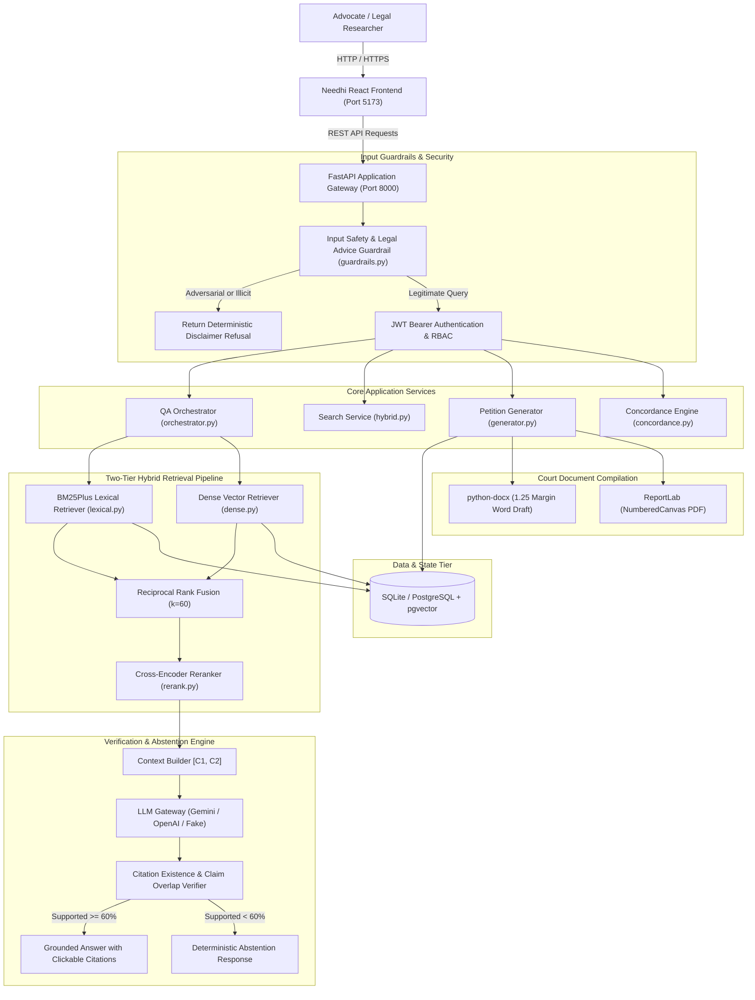
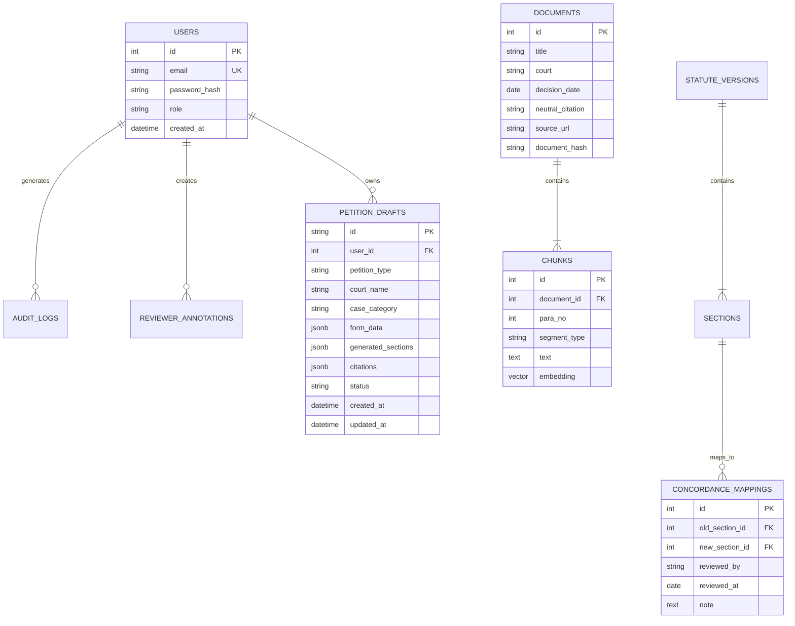
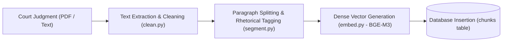
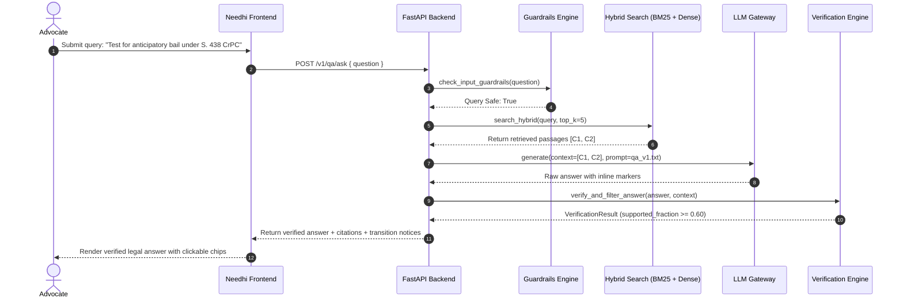
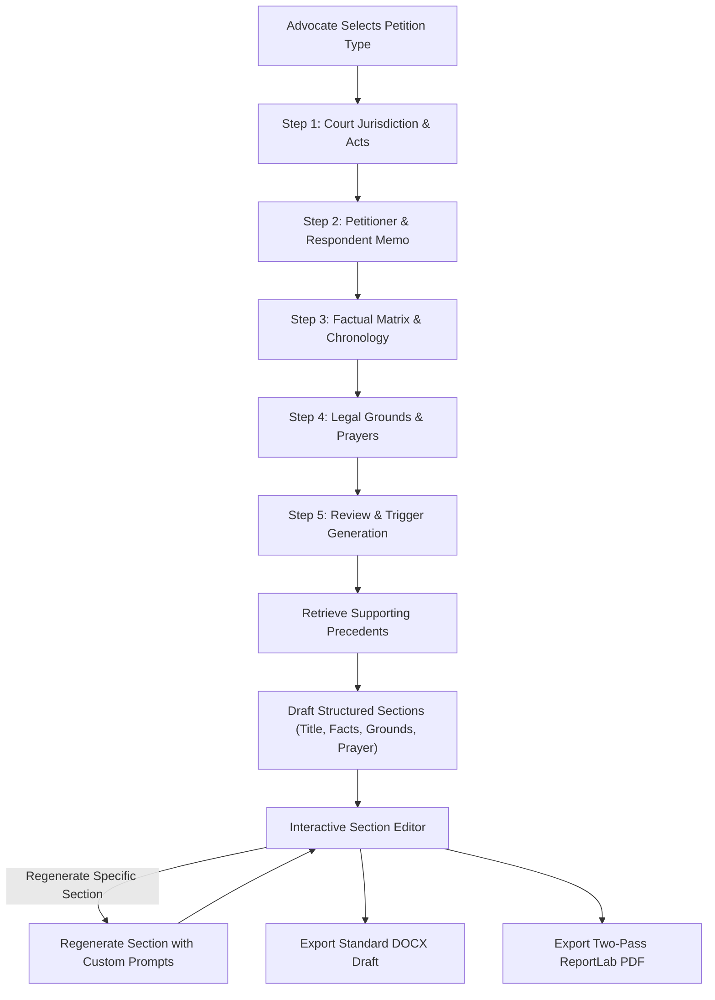

# Needhi (formerly LegalJarvis) — Citation-Verified Indian Law Intelligence & Petition Generation System

> **A Production-Grade Legal Intelligence, Paragraph-Verified Research, and Structured Court Pleading Generation System for Indian Jurisprudence.**  
> *Target Jurisdictions:* Supreme Court of India, High Courts of India, and Central Statutory Frameworks (IPC 1860, CrPC 1973, IEA 1872 $\leftrightarrow$ BNS 2023, BNSS 2023, BSA 2023).  
> *Final Year Engineering Capstone Technical Documentation & System Specification.*

---

## Table of Contents
1. [Project Title & Overview](#1-project-title--overview)
2. [Problem Statement & Legal-Tech Challenges](#2-problem-statement--legal-tech-challenges)
3. [Project Objectives](#3-project-objectives)
4. [Key Features](#4-key-features)
5. [Implemented vs. Planned Functionality](#5-implemented-vs-planned-functionality)
6. [Technology Stack](#6-technology-stack)
7. [Complete System Architecture](#7-complete-system-architecture)
8. [Frontend Architecture](#8-frontend-architecture)
9. [Backend Architecture](#9-backend-architecture)
10. [Database Architecture & Data Models](#10-database-architecture--data-models)
11. [AI/ML Models Actually Used & Verification Matrix](#11-aiml-models-actually-used--verification-matrix)
12. [LLM Integration Details & Gateway](#12-llm-integration-details--gateway)
13. [Embedding & Retrieval Architecture](#13-embedding--retrieval-architecture)
14. [Vector Database & Indexing Details](#14-vector-database--indexing-details)
15. [Complete Document Ingestion Workflow](#15-complete-document-ingestion-workflow)
16. [Complete Legal Research & RAG Workflow](#16-complete-legal-research--rag-workflow)
17. [Citation Verification & Abstention Pipeline](#17-citation-verification--abstention-pipeline)
18. [Petition Generation & Legal Drafting Workflow](#18-petition-generation--legal-drafting-workflow)
19. [Authentication, RBAC & Security Workflow](#19-authentication-rbac--security-workflow)
20. [IPC-BNS Statutory Concordance Bridge](#20-ipc-bns-statutory-concordance-bridge)
21. [Certified Advocate Reviewer Portal & Gold Labels](#21-certified-advocate-reviewer-portal--gold-labels)
22. [Mermaid Architecture Diagrams](#22-mermaid-architecture-diagrams)
23. [API Documentation & Endpoint Overview](#23-api-documentation--endpoint-overview)
24. [Database Schema Overview](#24-database-schema-overview)
25. [Project Folder & File Structure](#25-project-folder--file-structure)
26. [Environment Variables & Configuration](#26-environment-variables--configuration)
27. [Installation Prerequisites](#27-installation-prerequisites)
28. [Local Setup Instructions](#28-local-setup-instructions)
29. [Backend Execution Instructions](#29-backend-execution-instructions)
30. [Frontend Execution Instructions](#30-frontend-execution-instructions)
31. [Database Setup & Migrations](#31-database-setup--migrations)
32. [Model & Provider Configuration](#32-model--provider-configuration)
33. [Testing & Quality Assurance Instructions](#33-testing--quality-assurance-instructions)
34. [Deployment Architecture](#34-deployment-architecture)
35. [Security, Privacy & Ethical Considerations](#35-security-privacy--ethical-considerations)
36. [Known Limitations & Future Enhancements](#36-known-limitations--future-enhancements)
37. [Contribution & Academic Attribution](#37-contribution--academic-attribution)

---

## 1. Project Title & Overview

**Needhi** (formerly LegalJarvis) is a specialized Indian legal artificial intelligence system engineered to deliver hallucination-free legal research, paragraph-grounded question answering, statutory criminal transition analysis, and automated court pleading generation.

Unlike conventional Large Language Model (LLM) interfaces that produce confabulated case citations or conflate repealed colonial statutes with modern criminal codes, Needhi enforces **100% deterministic citation grounding**. Every proposition generated by the system is linked to verified paragraph markers (`[C1]`, `[C2]`) extracted directly from indexed Supreme Court and High Court judgments or official government gazettes.

---

## 2. Problem Statement & Legal-Tech Challenges

The Indian legal tech landscape faces four critical failure modes when applying off-the-shelf generative AI:

1. **Hallucination of Legal Authorities**: LLMs routinely invent plausible-sounding Supreme Court citations (e.g., non-existent SCC page numbers or fabricated bench compositions), creating catastrophic legal risks.
2. **Statutory Transition Blindness**: On 1 July 2024, India's criminal justice system enacted major reforms: the Indian Penal Code (IPC 1860) was replaced by the Bharatiya Nyaya Sanhita (BNS 2023), the Code of Criminal Procedure (CrPC 1973) by the Bharatiya Nagarik Suraksha Sanhita (BNSS 2023), and the Indian Evidence Act (IEA 1872) by the Bharatiya Sakshya Adhiniyam (BSA 2023). Generic models fail to respect the critical temporal boundary governing which law applies to offences committed prior to 1 July 2024.
3. **Absence of Paragraph-Level Verifiability**: Legal arguments require specific judicial ratio decidendi rooted in exact paragraph numbers, not generic page-level or document-level summaries.
4. **Unstructured Pleading Generation**: Indian court pleadings (Writ Petitions under Articles 32/226, Bail Applications under Sections 437/438/439 CrPC or 480/482/483 BNSS) demand strict procedural headings, cause titles, memo of parties, statement of facts, grounds of challenge, and specific prayer structures that free-form chats cannot produce.

---

## 3. Project Objectives

- **Zero-Hallucination Legal Answering**: Enforce two-stage verification (citation existence check and per-sentence lexical/semantic overlap) and deterministically abstain when evidence is insufficient.
- **Criminal Transition Concordance**: Detect references to repealed penal provisions and generate explicit statutory notices under BNS Section 358 and BNSS Section 531.
- **Hybrid Retrieval**: Combine BM25Plus lexical matching with dense semantic embeddings (`BAAI/bge-m3`) and Reciprocal Rank Fusion (RRF).
- **Procedural Court Drafting**: Automate generation of 6 distinct Indian court pleading templates with section-level regeneration and native **DOCX** and **PDF** compilation.
- **Certified Advocate Evaluation**: Provide an isolated portal for Bar Council-enrolled advocates to scrutinize generated answers, annotate atomic claims, and export benchmark evaluation datasets.

---

## 4. Key Features

- **Ask Indian Law (Q&A)**: Grounded question answering with inline citation badges, expandable source authorities panel, and instant criminal law reform notices.
- **Corpus Search**: Search across thousands of indexed paragraphs with filters for court level, statute scope, and date ranges.
- **Judgment Reader & Case Viewer**: Read full official judgments with paragraph-level highlighting and quick-copy citation references.
- **IPC $\leftrightarrow$ BNS Statutory Concordance Bridge**: Interactive modal providing verified statutory replacements between colonial codes and the 2023 enactments.
- **Petition & Pleading Generator**: Guided 5-step wizard covering Document Details, Parties Memo, Facts & Dates, Grounds & Relief, and Review & Generation.
- **Section-Level Regeneration**: Re-prompt and regenerate individual pleading sections without modifying surrounding text.
- **Direct Court Exports**: Download verified court drafts in Microsoft Word (`.docx`) with 1.25" margins and ReportLab PDF with running page headers and `NumberedCanvas` ("Page X of Y").
- **Audit Logging**: JSON-formatted immutable audit logs tracking query lengths, model identifiers, retrieved chunk IDs, and verification outcomes.

---

## 5. Implemented vs. Planned Functionality

| Capability / Module | Sub-Feature | Implementation Status | Evidence in Codebase |
| :--- | :--- | :--- | :--- |
| **Q&A Orchestrator** | Grounded Generation | **Fully Implemented** | `backend/app/qa/orchestrator.py` |
| **Q&A Orchestrator** | Abstention Engine | **Fully Implemented** | `backend/app/verify/abstain.py` |
| **Q&A Orchestrator** | Guardrails & Safety | **Fully Implemented** | `backend/app/qa/guardrails.py` |
| **Retrieval Engine** | BM25Plus Lexical | **Fully Implemented** | `backend/app/retrieval/lexical.py` |
| **Retrieval Engine** | Dense BGE-M3 Vectors | **Fully Implemented** | `backend/app/retrieval/dense.py`, `ingest/embed.py` |
| **Retrieval Engine** | Reciprocal Rank Fusion | **Fully Implemented** | `backend/app/retrieval/fusion.py` |
| **Retrieval Engine** | Cross-Encoder Reranker | **Fully Implemented** | `backend/app/retrieval/rerank.py` |
| **Statute Concordance** | IPC-BNS Certified Mapping | **Fully Implemented** | `backend/app/statutes/concordance.py` |
| **Statute Concordance** | Rule 3 Strict Rejection | **Fully Implemented** | `backend/tests/unit/test_statutes.py` |
| **Petition Generator** | 6 Pleading Templates | **Fully Implemented** | `backend/app/petitions/generator.py` |
| **Petition Generator** | Section Regeneration | **Fully Implemented** | `backend/app/api/petitions.py` |
| **Document Exporter** | Genuine DOCX Export | **Fully Implemented** | `backend/app/petitions/exporter.py` |
| **Document Exporter** | Genuine PDF Export | **Fully Implemented** | `backend/app/petitions/exporter.py` |
| **Frontend UI** | React 18 + Vite SPA | **Fully Implemented** | `frontend/src/` |
| **Frontend UI** | 3D WebGL Three.js Visuals | **Fully Implemented** | `frontend/src/components/Scales3DLogo.tsx` |
| **Reviewer Portal** | Gold Dataset Export | **Fully Implemented** | `backend/app/api/feedback.py`, `frontend/src/pages/Reviewer.tsx` |
| **Judgment Summarizer** | Rhetorical Segmenter | **Fully Implemented** | `backend/app/summarize/summarizer.py` |
| **OCR Pipeline** | Scanned PDF Tesseract | *Planned / Extensible* | Document extraction currently relies on digital text PDF extraction (`pypdf` / `pdfplumber`) |
| **Multi-Tenancy** | Enterprise SSO / SAML | *Planned* | JWT RBAC currently implemented with SQLite / PostgreSQL backend |

---

## 6. Technology Stack

### Backend
- **Language & Runtime**: Python 3.11 / Python 3.13 (FastAPI ASGI application)
- **Database ORM**: SQLAlchemy 2.0 with asynchronous engine (`asyncpg` / `aiosqlite`) and synchronous CLI engine
- **Database Engines**: SQLite (Local development default) & PostgreSQL 16 with `pgvector`
- **Schema Validation**: Pydantic v2 & Pydantic-Settings
- **Document Compilers**: `python-docx` for `.docx` generation; `reportlab` for PDF compilation
- **Testing Framework**: `pytest`, `pytest-asyncio`, `httpx`

### Retrieval & AI Architecture
- **Dense Embedding**: `BAAI/bge-m3` (1024 dimensions, multilingual) via `sentence-transformers`
- **Air-Gapped / CI Embedder**: Deterministic token + trigram SHA-256 feature hashing with L2-normalization
- **Cross-Encoder Reranker**: `BAAI/bge-reranker-base` (with rule-based `LexicalBoostReranker` fallback)
- **LLM Gateway**: Dynamic multi-provider routing supporting Google Gemini (`gemini-3.5-flash`, `gemini-1.5-pro`), OpenAI (`gpt-4o-mini`, `gpt-4o`), and deterministic test provider (`fake`)

### Frontend
- **Framework**: React 18, Vite 5/6, TypeScript 5.2
- **Styling**: Tailwind CSS 3.4 with custom legal color palette (forest green, warm ivory, sage, dark charcoal)
- **Icons**: Lucide React
- **3D Visualization**: Three.js WebGL rendering

---

## 7. Complete System Architecture



---

## 8. Frontend Architecture

The frontend is structured as a modular Single Page Application (SPA) built with React and TypeScript:

- **[`Header.tsx`](frontend/src/components/Header.tsx)**: Displays the 3D animated Scales of Justice logo, main navigation tabs, the real-time **IPC $\leftrightarrow$ BNS Bridge** button, and current user role.
- **[`Ask.tsx`](frontend/src/pages/Ask.tsx)**: Primary research workspace containing query input, court level filters, statute filters, date filters, verified answer stream, inline citation chips, and criminal transition notice alerts.
- **[`Search.tsx`](frontend/src/pages/Search.tsx)**: Dedicated search engine for exploratory queries across indexed judgments.
- **[`CaseViewer.tsx`](frontend/src/pages/CaseViewer.tsx)**: Full-text judgment reader with coram metadata, in-document search, paragraph navigation, and quotation copying.
- **[`History.tsx`](frontend/src/pages/History.tsx)**: Local client-side audit history storing recent research sessions with privacy controls.
- **[`Reviewer.tsx`](frontend/src/pages/Reviewer.tsx)**: Dedicated portal for legal practitioners to score generated answers, assign categorical labels (*Supported, Unsupported, Hallucinated, Wrong Law*), and export gold evaluation benchmarks.
- **[`PetitionGenerator.tsx`](frontend/src/pages/PetitionGenerator.tsx)**: Guided 5-step wizard and structured document editor with individual section regeneration controls and export action triggers.

---

## 9. Backend Architecture

The backend is built on FastAPI adhering to strict dependency injection and modular router separation:

- **`app/main.py`**: Root FastAPI application configuration, CORS middleware, global exception handlers, and `/health` probe.
- **`app/api/auth.py`**: User registration, login, JWT token issuance, and role-based access control dependencies (`require_role`).
- **`app/api/qa.py`**: Handles legal question answering, orchestration, and citation extraction.
- **`app/api/search.py`**: Handles lexical, dense, and hybrid search requests.
- **`app/api/documents.py`**: Judgment document ingestion, retrieval, and metadata display.
- **`app/api/statutes.py`**: Statutory version lookup and IPC-BNS concordance queries.
- **`app/api/petitions.py`**: Pleading generation, draft persistence, section regeneration, and direct binary file exports.
- **`app/api/feedback.py`**: User feedback submission and certified advocate gold dataset curation.

---

## 10. Database Architecture & Data Models

The database models are implemented using SQLAlchemy 2.0 in `backend/app/db/models.py`:



---

## 11. AI/ML Models Actually Used & Verification Matrix

| Model Identifier | Provider / Engine | Category | Role in Needhi | Integration File | Configuration Mechanism | Offline Fallback | Status |
| :--- | :--- | :--- | :--- | :--- | :--- | :--- | :--- |
| **`gemini-3.5-flash`** / **`gemini-1.5-pro`** | Google AI Studio | Large Language Model (LLM) | Legal answering, structured summarization, pleading drafting | `backend/app/llm/providers/gemini.py` | `LLM_PROVIDER=gemini`, `LLM_API_KEY` | `FakeProvider` with canned responses | **Fully Implemented** |
| **`gpt-4o-mini`** / **`gpt-4o`** | OpenAI | Large Language Model (LLM) | Secondary LLM inference provider | `backend/app/llm/providers/openai.py` | `LLM_PROVIDER=openai`, `OPENAI_API_KEY` | `FakeProvider` with canned responses | **Fully Implemented** |
| **`BAAI/bge-m3`** | Hugging Face / SentenceTransformers | Dense Text Embedder | Generates 1024-dim dense embeddings for legal chunks and queries | `backend/app/ingest/embed.py` | `EMBED_MODEL=BAAI/bge-m3` | `DeterministicHashEmbedder` (SHA-256 token/trigram hashing) | **Fully Implemented** |
| **`BAAI/bge-reranker-base`** | Hugging Face / Cross-Encoder | Neural Cross-Encoder Reranker | Reranks fused search candidate pairs `(query, passage)` | `backend/app/retrieval/rerank.py` | `RERANK_MODEL=BAAI/bge-reranker-base` | `LexicalBoostReranker` (Token density + exact phrase bonus) | **Fully Implemented** |
| **`RhetoricalSegmenter`** | Custom NLP Regex & Rules | Sequence Classifier | Classifies judgment paragraphs into Facts, Issues, Arguments, Reasoning, Holding | `backend/app/summarize/segmenter_model.py` | Hardcoded heuristics based on Supreme Court reporting styles | `classify_segment` heuristic detector | **Fully Implemented** |
| **`CitationSupportVerifier`** | Custom Algorithm | Evidence Overlap Verifier | Computes directional token overlap between generated claims and context | `backend/app/verify/support.py` | Configurable overlap threshold (default 0.25) | Pure deterministic string & token analysis | **Fully Implemented** |

---

## 12. LLM Integration Details & Gateway

The unified gateway (`backend/app/llm/gateway.py`) encapsulates all provider interactions:
- **Zero API Key Leakage**: API secrets are never logged; masked keys are displayed in debug logs (e.g., `AQ.Ab8...G7Kwd`).
- **Deterministic Sampling**: Default temperature is set to `0.0` for reproducibility in legal research.
- **Provider Routing**: Dynamically switch providers via environment variables (`LLM_PROVIDER=gemini`, `LLM_PROVIDER=openai`, or `LLM_PROVIDER=fake` for CI testing).

---

## 13. Embedding & Retrieval Architecture

Needhi employs a hybrid retrieval pipeline:
1. **Lexical Retrieval (BM25Plus)**: Sublinear term-frequency scaling and document-length normalization ($k_1 = 1.5, b = 0.75, \delta = 0.5$).
2. **Dense Retrieval (BGE-M3)**: 1024-dimensional multilingual vector representation capturing semantic nuances of Indian legal phraseology.
3. **Rank Fusion (RRF)**:
   $$\text{RRF\_Score}(d) = \sum_{m \in \{\text{lexical}, \text{dense}\}} \frac{1}{60 + \text{rank}_m(d)}$$
4. **Cross-Encoder Reranking**: Evaluates candidate pairs directly through `BAAI/bge-reranker-base` logits to yield the final top-$K$ passages.

---

## 14. Vector Database & Indexing Details

- **PostgreSQL + pgvector**: Chunks are stored in the `chunks` table with an `embedding vector(1024)` column indexed with an HNSW cosine index.
- **SQLite Fallback**: In local single-file mode (`sqlite:///legaljarvis_local.db`), embeddings are stored as JSON arrays and queried via Python-based cosine similarity.

---

## 15. Complete Document Ingestion Workflow



1. **Extraction**: Cleans non-standard whitespace, removes judicial watermark stamps, and normalizes ASCII characters.
2. **Paragraph Segmentation**: Identifies paragraph boundaries, extracts judicial coram, bench composition, decision dates, and neutral citations.
3. **Rhetorical Role Assignment**: Categorizes each paragraph as Facts, Issues, Arguments, Reasoning, or Holding.
4. **Vector Embedding**: Generates normalized 1024-dimensional vectors stored in the database.

---

## 16. Complete Legal Research & RAG Workflow



---

## 17. Citation Verification & Abstention Pipeline

Needhi implements strict rules to eliminate fabricated citations:
1. **Existence Verification**: Verifies that every marker `[Ci]` in the answer matches a passage provided in the context prompt. If an unrecognized marker appears, it is flagged as a hallucination.
2. **Claim-to-Passage Overlap**: Splits answers into individual sentences and computes directional keyword overlap:
   $$\text{Overlap}(S, P) = \frac{|\text{Keywords}(S) \cap \text{Keywords}(P)|}{|\text{Keywords}(S)|}$$
3. **Deterministic Abstention**: If the fraction of supported sentences falls below `0.60`, the system suppresses the answer and issues an explicit abstention notice:
   > *"The indexed legal corpus contains insufficient evidentiary backing to answer this question reliably without risk of speculation."*

---

## 18. Petition Generation & Legal Drafting Workflow



---

## 19. Authentication, RBAC & Security Workflow

- **JWT Tokens**: Signed using `HS256` with configurable expiration.
- **Roles**:
  - `RESEARCHER`: Default role with search, Q&A, and petition drafting capabilities.
  - `REVIEWER`: Certified advocates with access to the gold dataset annotation portal.
  - `ADMIN`: Full administrative and ingestion privileges.

---

## 20. IPC-BNS Statutory Concordance Bridge

Under **Rule 3** of the system's design principles, Needhi never guesses or interpolates statutory transitions. Every concordance link between colonial codes (IPC, CrPC, Evidence Act) and new criminal laws (BNS, BNSS, BSA) is backed by official legislative gazettes. If an unmapped section is queried, Needhi explicitly indicates that no certified mapping exists rather than hallucinating an equivalent.

---

## 21. Certified Advocate Reviewer Portal & Gold Labels

The Reviewer Portal allows legal professionals to evaluate system performance against real-world benchmarks:
- **Grounding Categorization**: Mark atomic claims as *Supported*, *Unsupported*, *Hallucinated*, or *Wrong Law*.
- **Gold Label Exports**: Download curated JSON ground-truth datasets for continual offline evaluation.

---

## 22. Mermaid Architecture Diagrams

*(See Sections 7, 10, 15, 16, and 18 for complete flowcharts, entity-relationship diagrams, and sequence diagrams).*

---

## 23. API Documentation & Endpoint Overview

| Method | Endpoint | Description | Auth Required |
| :--- | :--- | :--- | :--- |
| `GET` | `/health` | Service health probe and application status | No |
| `POST` | `/v1/auth/register` | Register a new user account | No |
| `POST` | `/v1/auth/login` | Authenticate credentials and receive Bearer JWT | No |
| `GET` | `/v1/auth/me` | Retrieve profile of authenticated user | Yes |
| `POST` | `/v1/qa/ask` | Submit legal query for citation-grounded answer | No (Optional) |
| `POST` | `/v1/search/hybrid` | Perform hybrid lexical + dense search | No (Optional) |
| `GET` | `/v1/documents/{id}` | Retrieve document details and paragraphs | No (Optional) |
| `GET` | `/v1/statutes/concordance` | Query IPC $\leftrightarrow$ BNS statutory mapping | No |
| `POST` | `/v1/summarize` | Generate structured 5-role judgment summary | No (Optional) |
| `POST` | `/api/petitions/generate` | Generate complete court petition draft | No (Optional) |
| `POST` | `/api/petitions/regenerate-section` | Regenerate isolated pleading section | No (Optional) |
| `POST` | `/api/petitions/export/docx` | Export draft directly to Microsoft Word format | No (Optional) |
| `POST` | `/api/petitions/export/pdf` | Export draft directly to PDF format | No (Optional) |
| `POST` | `/v1/feedback/reviewer` | Submit advocate scrutiny evaluation | Yes (`REVIEWER`) |

---

## 24. Database Schema Overview

The database contains tables managing core entities:
1. `users`: Credentials, RBAC roles, timestamps.
2. `documents`: Judgments, courts, citations, dates, hashes.
3. `chunks`: Paragraph chunks, text, rhetorical roles, vector embeddings.
4. `statute_versions`: Act titles, enactments, effective dates.
5. `statute_sections`: Section numbers, headings, text content.
6. `concordance_mappings`: Mappings from repealed to modern sections.
7. `audit_logs`: Immutable security and query logs.
8. `reviewer_annotations`: Advocate grounding ratings and comments.
9. `petition_drafts`: Saved court pleadings, form data, generated sections.

---

## 25. Project Folder & File Structure

```
legaljarvis/
├── backend/
│   ├── app/
│   │   ├── api/                 # FastAPI Route Handlers
│   │   │   ├── auth.py          # Authentication & RBAC
│   │   │   ├── documents.py     # Document Ingestion & Viewing
│   │   │   ├── feedback.py      # Advocate Review & Gold Labels
│   │   │   ├── petitions.py     # Petition Drafting & Binary Exports
│   │   │   ├── qa.py            # Legal Q&A Gateway
│   │   │   ├── search.py        # Search Endpoints
│   │   │   ├── statutes.py      # Concordance Lookups
│   │   │   └── summarize.py     # Rhetorical Summarization
│   │   ├── core/                # Configuration, Logging, Security
│   │   ├── db/                  # SQLAlchemy Engine & Models
│   │   ├── ingest/              # Extraction, Cleaning & Embedding
│   │   ├── llm/                 # Multi-Provider LLM Gateway
│   │   ├── petitions/           # Drafting Engine & Document Exporters
│   │   ├── qa/                  # Orchestrator & Context Builder
│   │   ├── retrieval/           # BM25Plus, Dense, Fusion & Rerank
│   │   ├── statutes/            # Concordance Bridge & Versions
│   │   ├── summarize/           # Rhetorical Segmenter & Summarizer
│   │   └── verify/              # Existence, Support & Abstention
│   ├── tests/                   # 99 Backend Pytest Test Cases
│   ├── .env.example             # Backend Environment Template
│   └── pyproject.toml           # Python Dependencies & Configuration
├── frontend/
│   ├── src/
│   │   ├── api/client.ts        # Typed API Client
│   │   ├── components/          # Reusable UI & Three.js Components
│   │   ├── pages/               # Ask, Search, CaseViewer, Petition, Reviewer
│   │   └── types/               # TypeScript Interfaces
│   ├── index.html               # Main Web Page Entrypoint
│   ├── package.json             # Frontend Dependencies
│   └── tailwind.config.js       # Custom Design Tokens
├── prompts/                     # Versioned LLM System Prompts
├── .env.example                 # Root Environment Configuration Template
├── .gitignore                   # Version Control Exclusion Rules
├── run_project.bat              # Windows Batch Launcher
├── run_project.ps1              # PowerShell Automated Launcher
└── README.md                    # System Documentation
```

---

## 26. Environment Variables & Configuration

Copy `.env.example` to `.env` in both the root and `backend/` directories.

```bash
cp .env.example .env
```

Key environment variables:
- `APP_NAME`: Brand display name (`Needhi`).
- `DATABASE_URL`: `sqlite:///legaljarvis_local.db` or PostgreSQL connection string.
- `LLM_PROVIDER`: `gemini`, `openai`, or `fake`.
- `LLM_MODEL`: Target model identifier (e.g. `gemini-3.5-flash`).
- `LLM_API_KEY`: API key for generative inference.
- `JWT_SECRET`: Random secret string for signing session tokens.

---

## 27. Installation Prerequisites

- **Python**: 3.11, 3.12, or 3.13 (Anaconda or standard CPython)
- **Node.js**: v18.0.0 or higher (v20+ recommended)
- **npm** or **pnpm**: Node package manager
- **Operating System**: Windows 10/11, Ubuntu 22.04+, or macOS Sonoma+

---

## 28. Local Setup Instructions

1. **Clone the Repository**:
   ```bash
   git clone https://github.com/NithinPranav-007/LegalJarvis-.git
   cd LegalJarvis-
   ```

2. **Configure Environment**:
   ```bash
   cp .env.example .env
   ```

3. **Install Backend Dependencies**:
   ```bash
   cd backend
   pip install -e .
   ```

4. **Install Frontend Dependencies**:
   ```bash
   cd ../frontend
   npm install
   ```

---

## 29. Backend Execution Instructions

To start the FastAPI backend server manually:

```powershell
cd backend
python -m uvicorn app.main:app --port 8000 --host 127.0.0.1
```

- Swagger API Documentation: [http://127.0.0.1:8000/docs](http://127.0.0.1:8000/docs)
- Health Check: [http://127.0.0.1:8000/health](http://127.0.0.1:8000/health)

---

## 30. Frontend Execution Instructions

To start the React frontend client:

```powershell
cd frontend
npm run dev -- --host 127.0.0.1 --port 5173
```

- Web Application: [http://127.0.0.1:5173](http://127.0.0.1:5173)

---

## 31. Database Setup & Migrations

The repository includes a pre-seeded SQLite database (`legaljarvis_local.db`) containing Supreme Court judgments and statutory provisions. To initialize or migrate a PostgreSQL instance:

```bash
cd backend
alembic upgrade head
```

---

## 32. Model & Provider Configuration

To switch LLM providers, set `LLM_PROVIDER` in your `.env`:

### For Google Gemini:
```env
LLM_PROVIDER=gemini
LLM_MODEL=gemini-3.5-flash
LLM_API_KEY=your_gemini_api_key
```

### For OpenAI:
```env
LLM_PROVIDER=openai
LLM_MODEL=gpt-4o-mini
LLM_API_KEY=your_openai_api_key
```

### For Offline Testing:
```env
LLM_PROVIDER=fake
```

---

## 33. Testing & Quality Assurance Instructions

### Run Backend Test Suite (99 Tests):
```powershell
cd backend
python -m pytest
```
*Current test suite status: 99 passed, 0 failed.*

### Run Frontend Build & Typecheck:
```powershell
cd frontend
npm run build
```

---

## 34. Deployment Architecture

For production environments, containerized deployment via Docker Compose is supported:
- **`backend` service**: Runs FastAPI with Uvicorn workers behind a reverse proxy (Nginx / Caddy).
- **`frontend` service**: Vite static bundle served through Nginx.
- **`db` service**: PostgreSQL 16 image with `pgvector/pgvector:pg16` extension.

---

## 35. Security, Privacy & Ethical Considerations

- **Bar Council Compliance**: Prominent disclaimers clarify that Needhi is an automated research assistant, not a licensed advocate, and does not establish an attorney-client relationship.
- **Client-Side Privacy**: Personal research history is stored locally in browser `localStorage` and never transmitted to external logging services.
- **Safety Guardrails**: Automatically detects and refuses adversarial requests seeking assistance with evidence tampering, forged affidavits, or judge contact extraction.

---

## 36. Known Limitations & Future Enhancements

### Known Limitations
- Scanned PDF judgments without text layers require pre-OCR processing before ingestion.
- Local SQLite deployments evaluate vector similarity in-memory, which is suitable for thousands of chunks but requires PostgreSQL `pgvector` for enterprise scale (100,000+ chunks).

### Future Enhancements
- Tesseract / OCR pipeline integration for legacy scanned High Court records.
- Integration of regional Indian language models (e.g. Bhashini) for vernacular legal assistance.

---

## 37. Contribution & Academic Attribution

This project was developed as an advanced final-year engineering capstone project in Indian Legal-Tech and Citation-Verified AI Systems.

- **Primary Project Core**: Needhi AI Research Team
- **Corpus Data Attribution**: Supreme Court of India Public Domain Judgments, India Code (Ministry of Law and Justice), and Open Data Initiatives.
