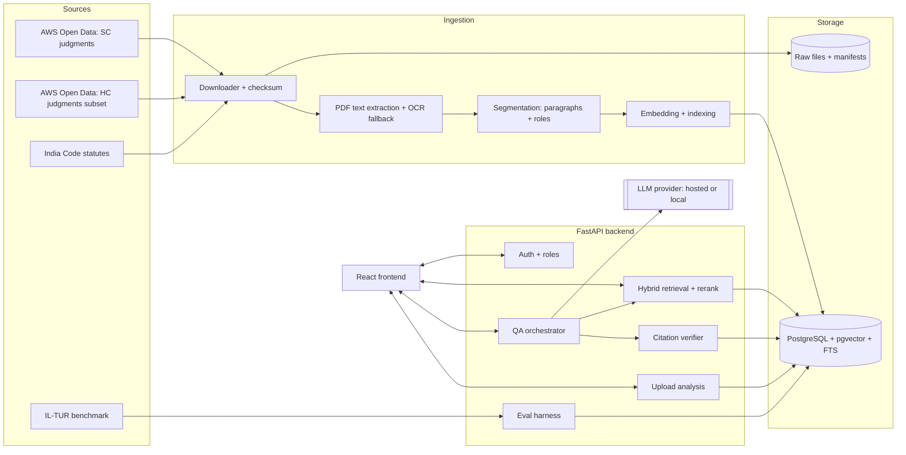
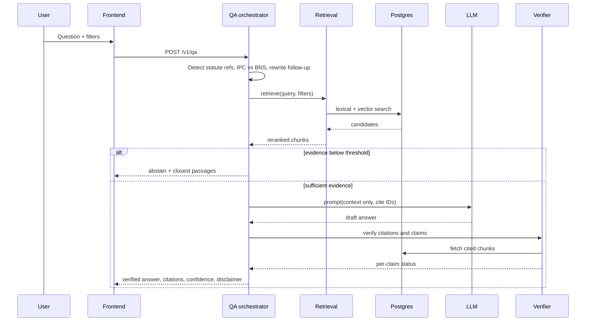
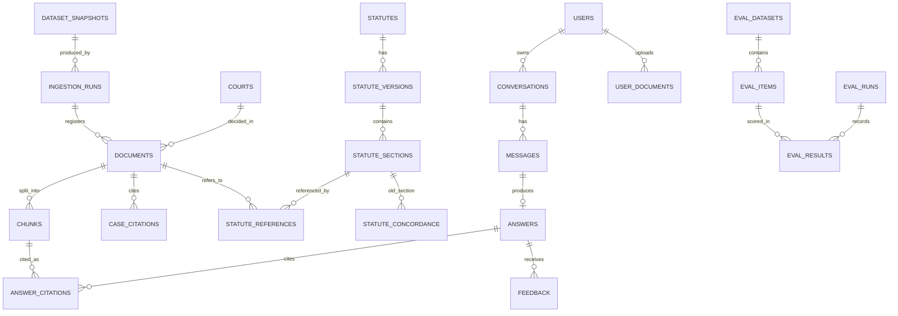

# 0. How to read this document

This document turns the supplied research report into an implementation-ready PRD and a build plan for Google Antigravity. It is organised in the ten deliverables you requested:

| Deliverable | Where |
|---|---|
| 1. Report analysis and gap assessment | Part A |
| 2. Research-backed technical recommendations | Part B |
| 3. Real-world dataset catalog and integration plan | Part C |
| 4. Complete PRD | Part D (sections D1–D18) |
| 5. Diagrams (architecture, workflow, ER, data flow) | Inside Part D (D5, D7, D8) |
| 6. Directory structure and roadmap | Part E |
| 7. Antigravity master execution prompt | Separate file: `Antigravity_Master_Execution_Prompt.md` |
| 8. Antigravity task-by-task plan | Part F |
| 9. Testing, validation and evaluation plan | Part G |
| 10. Completion checklist and documentation requirements | Part H |

## Evidence labels used throughout

- **[V]** Verified from a source I retrieved during this session (source named).
- **[E]** Established finding in published research (cited, not independently re-run).
- **[P]** Proposed engineering decision (my recommendation, justified).
- **[H]** Hypothesis that must be validated experimentally before being relied on.
- **[U]** Unverified in this session. Must be checked by the implementing agent before it becomes a dependency.

## Honesty statement

Nothing in this document has been executed. No dataset has been downloaded, no model has been run, no code has been tested, nothing has been deployed. Dataset facts below were read from landing pages and documentation via search; dataset sizes, schemas and file counts that I could not see are marked **[U]** and are assigned to Task T-02 (dataset probe) for first-hand verification. No performance figure for LegalJarvis is claimed anywhere.

---

# Part A — Deliverable 1: Report analysis and gap assessment

## A1. What the report actually contains

The uploaded PDF is five pages and contains **Sections 2–5 only** (Abstract, Executive Summary, Introduction and Background, Problem Definition and Decomposition). Section 1 (title/front matter) is also absent. Everything below is extracted from those pages.

| Item (your Phase 1 list) | Extracted from the report |
|---|---|
| 1. Title and domain | "LegalJarvis: AI-Powered Legal Research and Assistance System". Legal technology, AI, NLP. Section 5 assumes the title "LegalJarvis: AI-powered Legal Document Analysis and Q&A". |
| 2. Real-world problem | Legal texts are long, structured, jargon-heavy and voluminous; manual reading is slow; ordinary citizens have limited access to understandable legal information. |
| 3. Background | Transformer LMs (GPT-3, LegalBERT) have advanced legal NLP; general LLMs hallucinate; legal training data is scarce; retrieval grounding is needed. |
| 4. Objectives | Build a prototype assistant that retrieves legal material, summarises documents and answers questions with citations. |
| 5. Users | Lawyers/paralegals, legal-aid workers, policy makers/academics, citizens. |
| 6. Existing approaches | Rule-based → statistical → transformer; LegalBERT; GPT-style LLMs; RAG. Section 9 (existing tools) is not in the file. |
| 7. Proposed solution | Hybrid: semantic + keyword retrieval, legal-domain language model, generation for answers/summaries, clause-level analysis, human-in-the-loop evaluation. |
| 8. Requirements | Five functional and five non-functional requirements (Section 5). |
| 9. Technical needs | Legal corpora, retrieval index, pretrained legal model, generator, English-only initially. |
| 10. Outputs/success | ≥75% QA correctness (COLIEE / "caseQA"), ROUGE-L above baselines, ≥4/5 satisfaction, ≥90% top-5 retrieval relevance. |
| 11. Assumptions | English only; legal corpora accessible; human oversight; "Indian law if the company is India-based". |
| 12. Research gaps | Argument-aware summarisation, robust legal QA (named, but Section 10 is missing). |

## A2. Critical findings

Severity: **High** = blocks implementation or invalidates a success criterion; **Med** = needs a decision; **Low** = clean-up.

| # | Finding | Severity | Resolution in this PRD |
|---|---|---|---|
| G1 | **Report is incomplete.** The executive summary refers to Sections 4–24 (literature review, existing tools, architecture, datasets, algorithms, methodology, evaluation, risks, timeline) and 26 (references). The file ends at Section 5. | High | I did not invent the missing sections. Architecture, datasets, methodology and evaluation are designed here from first principles and marked [P]. If the missing sections exist, reconcile them against this PRD before build. |
| G2 | **No resolvable references.** Citations like 【19†L388-L396】 are tool-citation artefacts, not bibliographic entries, and Section 26 is absent. No claim in the report can be traced to a paper. | High | Part B re-grounds the key claims in sources I could retrieve. Treat the report's own citations as unverified. |
| G3 | **Jurisdiction undecided.** "Indian law if the company is India-based." The report names "LegalJarvis AI Labs" as a source of mission statement but never states the target jurisdiction. | High | **Decision [P]: Indian law, English-language texts, Supreme Court + selected High Courts + central statutes.** This is the only choice that the open data available (Part C) supports well. Changing jurisdiction changes the whole dataset plan. |
| G4 | **Success criterion mismatch.** "≥75% on COLIEE or caseQA." COLIEE 2026 covers Canadian case law and Japanese statute law (Japanese-language data) **[V: COLIEE 2026 call for participation]**; it cannot measure Indian-law performance. "caseQA" is not an identifiable benchmark. | High | Replaced with Indian-law evaluation built on IL-TUR tasks plus an expert-annotated gold set (D16, Part G). |
| G5 | **Other criteria are under-specified.** "ROUGE-L above established baselines" (which baseline? which dataset?); "relevant documents in top-5 ≥90% of the time" (precision@5 vs hit-rate@5?) is very ambitious for case retrieval; "≥4/5 satisfaction" has no sample size. | Med | Criteria re-stated with metric definitions, baselines measured first, targets set as hypotheses (D16). |
| G6 | **Model conflation.** LegalBERT/InLegalBERT are encoder-only masked language models. They cannot generate answers or summaries and are not ready-made sentence-embedding models. The report lists "a pretrained legal language model (e.g. LegalBERT or a fine-tuned LLM)" as one component. | Med | Separate roles: encoder for classification/segmentation/reranking features; embedding model for dense retrieval; generative LLM for synthesis (D9). |
| G7 | **"Legal accuracy against case law" has no ground truth.** There is no named gold dataset or annotation process. | High | Gold set creation with legal reviewers is a named deliverable and a named dependency (Part G). Without it, legal correctness cannot be claimed. |
| G8 | **RAG is treated as a hallucination fix.** Evidence says it reduces but does not eliminate it: in a preregistered study, Lexis+ AI and Westlaw AI-Assisted Research (both RAG-based) hallucinated on roughly 17% and 33% of queries, versus about 43% for GPT-4 **[V: Magesh et al., J. Empirical Legal Studies 2025, doi:10.1111/jels.12413; figures as summarised by LLRX, verify against paper]**. | High | Add post-generation citation verification and abstention as P0 requirements (FR-05, FR-06), not "nice to have". |
| G9 | **Statute law changed under the project's feet.** The Bharatiya Nyaya Sanhita (BNS) 2023, Bharatiya Nagarik Suraksha Sanhita (BNSS) 2023 and Bharatiya Sakshya Adhiniyam (BSA) 2023 replaced the IPC, CrPC and Evidence Act with effect from 1 July 2024 **[V: MHA notification as reported by LiveLaw, Business Standard]**; offences before that date generally continue under the old law. Most judgments in any corpus cite IPC/CrPC section numbers. | High | Statute versioning and IPC↔BNS handling are explicit requirements (FR-13). The mapping table must be built from official sources with legal review. I do not fabricate it here. |
| G10 | **Scope contradicts itself.** Scope says "litigation and case-management scenarios" and excludes transactional tasks; the executive summary's lead example is a *contract* question ("key obligations of Party A"). | Med | Contracts are supported as **user-uploaded documents only (zero-shot, P1)** and are explicitly out of the validated scope because no Indian contract benchmark has been identified. |
| G11 | **Privacy vs. upload feature.** Users upload contracts and judgments; the report mentions privacy only in one line. | Med | Uploaded documents are private, encrypted at rest where the host allows, retention-limited, never used for training, never mixed into the shared index (D12). Review India's Digital Personal Data Protection Act, 2023 applicability **[U]**. |
| G12 | **Unauthorised legal advice risk.** Citizens are an intended user group. | Med | The product is positioned as legal *information and research* with mandatory disclaimers and refusal to give case-specific advice; counsel review of wording is a launch gate (D12, Part H). |
| G13 | **Compute/budget not stated.** Full High Court corpus is on the order of a terabyte of PDFs **[V: Open Justice India listing says ~1 TB]**; fine-tuning an LLM is implied. | Med | A phased subset strategy and a no-fine-tuning-first rule (D9, Part C). |
| G14 | **Name collision.** The report references "LegalJarvis AI Labs." | Low | Run a trademark/name check before public launch. |
| G15 | **Numbering/format defects.** Section 1 missing, "Section 5" labelled "Problem Definition" while the summary calls it Sections 4–7. | Low | Cosmetic; noted for the next revision of the report. |

## A3. Preserved vs. changed

**Preserved:** the core objective (a legal assistant that retrieves, summarises and answers questions with citations), the user groups, the hybrid retrieval-plus-generation approach, citation traceability, human-in-the-loop evaluation.

**Changed, with justification:**

1. Jurisdiction fixed to India (G3).
2. COLIEE-based success criterion replaced (G4).
3. Hallucination controls promoted to P0 (G8).
4. "Fine-tuned legal LLM" demoted to a later, optional experiment; baseline is retrieval plus a general LLM, because there is no Indian legal QA training set to justify fine-tuning, and fine-tuning is out of reach for typical student/prototype compute (G13) **[P]**.

## A4. Assumptions (all [P] unless stated)

| ID | Assumption |
|---|---|
| AS-1 | Target jurisdiction: India; texts in English. Regional-language judgments are present in the open data but are out of scope for v1. |
| AS-2 | Team is small, budget near zero: free/open tools preferred, one developer laptop or a single modest cloud VM. |
| AS-3 | Hosted LLM access (an API key with free or low-cost tier) or a locally run open-weights model is available. Exact model is configurable. |
| AS-4 | Access to at least one legal reviewer (advocate or senior law student) for 4–6 hours per week for gold-set creation and answer review. This is a hard dependency for any legal-correctness claim. |
| AS-5 | The system is a prototype for research use, not a deployed legal-advice product. |
| AS-6 | Project length about 12 weeks; the roadmap is built around that. |

---

# Part B — Deliverable 2: Research-backed technical recommendations

## B1. Sources used (each retrieved this session)

| # | Title | Organisation / venue | URL | Relevance | Access |
|---|---|---|---|---|---|
| S1 | IL-TUR: Benchmark for Indian Legal Text Understanding and Reasoning (Joshi et al., 2024) | ACL 2024 | https://aclanthology.org/2024.acl-long.618 · https://arxiv.org/abs/2407.05399 · leaderboard https://exploration-lab.github.io/IL-TUR/ | Eight Indian-law tasks (English and 9 Indian languages) plus baselines and leaderboard; evaluation backbone | Open; per-task data licences **[U]** |
| S2 | Pre-trained Language Models for the Legal Domain: A Case Study on Indian Law (Paul et al., ICAIL 2023) | ICAIL 2023 | https://arxiv.org/abs/2209.06049 | InLegalBERT: Indian-law encoder; trained on ~5.4M Indian legal documents (about 27 GB), cases 1950–2019 | Paper open |
| S3 | InLegalBERT model card | law-ai (IIT Kharagpur), Hugging Face | https://huggingface.co/law-ai/InLegalBERT | MIT licence, BERT-base (~110M parameters); fill-mask model | Open |
| S4 | Hallucination-Free? Assessing the Reliability of Leading AI Legal Research Tools (Magesh et al.) | J. Empirical Legal Studies 2025, doi:10.1111/jels.12413; arXiv 2405.20362 | https://arxiv.org/abs/2405.20362 | Evidence that RAG legal tools still hallucinate; typology of hallucination and incompleteness | Open access (CC BY-NC) |
| S5 | COLIEE 2026 Call for Participation | COLIEE organisers / ICAIL 2026 | https://coliee.org/ | Shows COLIEE is Canadian case law and Japanese statute law; registration required | Registration |
| S6 | New criminal laws in force from 1 July 2024 | MHA notification reported by LiveLaw | https://www.livelaw.in/amp/top-stories/new-criminal-laws-replacing-ipc-crpc-evidence-act-to-come-into-force-from-july-1-2024-250395 | BNS/BNSS/BSA replace IPC/CrPC/Evidence Act | Public |
| S7 | India Code (Bharatiya Nyaya Sanhita, 2023 record) | Legislative Department / NIC | https://www.indiacode.nic.in/handle/123456789/20062 | Official statute repository | Public; bulk-download terms **[U]** |

Datasets are catalogued separately in Part C.

## B2. Recommended technical approach

| Question | Recommendation | Basis |
|---|---|---|
| Overall pattern | **Hybrid retrieval-augmented generation (RAG)** over an Indian-law corpus with **post-generation citation verification** and **abstention** | [E] S4 shows grounding helps but does not eliminate error; verification is a [P] mitigation |
| Retrieval | BM25-style lexical + dense embeddings, fused by Reciprocal Rank Fusion, then cross-encoder rerank; **measure each against IL-TUR prior-case-retrieval before choosing** | [P]; each component's contribution is [H] |
| Embedding model | Evaluate 2–3 general retrieval embedding models (candidates: BAAI bge-m3, multilingual-e5, and an InLegalBERT-initialised sentence encoder if time permits). Licences and model cards **[U]** must be checked on adoption | [H]; InLegalBERT alone is not a trained sentence-embedding model |
| Legal-domain encoder | Use InLegalBERT for sentence/rhetorical-role tagging (segmentation) and as a reranker initialisation, where fine-tuning on IL-TUR tasks is cheap | [E] S2; [P] role |
| Generator | Provider-agnostic LLM interface (hosted API or local open-weights). **Zero fine-tuning in v1.** Prompting enforces "answer only from provided context; cite chunk IDs; say you cannot answer if context is insufficient" | [P] |
| Summarisation | Structured, section-wise summaries (Facts / Issues / Arguments / Reasoning / Holding) using segmentation, not a single-pass abstractive blur; every summary sentence must trace to a source span | [P]; addresses the report's own "argument-aware summarisation" gap |
| Long documents | Paragraph-aware chunking with parent-child retrieval; Indian judgments use numbered paragraphs, which give natural citation anchors | [P]; avg SC judgment length ~4,000 words per S1 |
| Statutes | Section-level chunks with effective-date metadata and an explicit supersession link (IPC→BNS etc.) | [P] driven by G9 |
| Explainability | Show retrieved passages, highlight cited spans, expose confidence/abstention reason | [P] |

## B3. What is open-source and comparable

| System | What it shows | Link |
|---|---|---|
| IL-TUR leaderboard and baselines | Existing Indian-law baselines to compare against | https://exploration-lab.github.io/IL-TUR/ |
| Law-AI group code and datasets (IIT Kharagpur) | InLegalBERT pre-training code, Indian legal datasets | https://github.com/Law-AI **[U: contents]** |
| indian-supreme-court-judgments (downloader and docs) | Reference scripts for the open SC archive | https://github.com/vanga/indian-supreme-court-judgments |
| Commercial: Lexis+ AI, Westlaw AI, Indian Kanoon (search + PRISM), Vaquill | Positioning; competitor claims should not be assumed accurate | S4 for the first two; others **[U]** |

## B4. Risks and opportunities for innovation

- **Opportunity:** open Indian judgments (CC-BY-4.0, Part C) plus IL-TUR enable a *fully reproducible* Indian-law RAG evaluation, which commercial tools do not offer.
- **Opportunity:** a **citation-verified answer** pipeline with measurable "supported-claim rate" is a concrete, defensible research contribution matching the report's emphasis on "legal reasoning consistency".
- **Risk:** temporal drift (law changes; BNS) and contamination: InLegalBERT's pre-training corpus covers cases up to 2019 (S2), so any evaluation on pre-2020 judgments is contaminated for that encoder, and general LLMs may have seen public judgments. **Mitigation:** build the gold set from 2023–2025 judgments and report contamination caveats.

---

# Part C — Deliverable 3: Real-world dataset catalog

## C1. Inventory

| ID | Dataset | Provider | Verified facts [V] | Used for | Priority |
|---|---|---|---|---|---|
| DS-1 | **Indian Supreme Court Judgments** | Dattam Labs, via AWS Open Data | Judgments from eCourts; 1950 to 2025 per AWS Marketplace listing; English and regional-language PDFs; raw JSON metadata plus structured Parquet metadata; updated bi-monthly; **CC-BY-4.0**; public S3 bucket `indian-supreme-court-judgments` (region ap-south-1), readable with `--no-sign-request` | Core case-law corpus; retrieval, QA, summarisation | P0 |
| DS-2 | **Indian High Court Judgments** | Dattam Labs, via AWS Open Data | 25 High Courts; metadata in JSON and Parquet; **CC-BY-4.0**; bucket `indian-high-court-judgments` (ap-south-1); creator's post cites ~15.9 million judgment PDFs; Open Justice India listing says ~1 TB total, quarterly updates | Breadth; **use a small subset only** | P1 |
| DS-3 | **IL-TUR** (8 tasks: L-NER, RR, CJPE, BAIL, LSI, PCR, SUMM, L-MT) | Joshi et al., IIT Kanpur/Kharagpur et al. | ACL 2024; English, Hindi, 9 Indian languages; baselines and public leaderboard | Component evaluation: PCR (retrieval), SUMM (summarisation), LSI (statute identification), RR (rhetorical roles) | P0 |
| DS-4 | **India Code** (statutes) | Legislative Department / NIC | Official repository of central Acts incl. BNS 2023 record | Statute corpus | P0 |
| DS-5 | **Indian Kanoon API** | Indian Kanoon | Paid, prepaid per-request API; pricing page states non-commercial use gets free credit each month after use-case verification; terms require an agreement to charges; third-party commentary says API terms require attribution branding **[U: verify in terms]** | Optional live lookup and citation cross-check; **not a required dependency** | P2 |
| DS-6 | **DAKSH High Court (Writ) data** | DAKSH | Case and hearing records for 23 of 25 HCs; Open Database Licence (ODbL) | Optional metadata analytics; not needed for v1 | P2 |
| DS-7 | **COLIEE** | COLIEE organisers | Canadian case law, Japanese statutes; registration required | **Not used for Indian-law claims.** Optional transfer-learning study only | P2 / excluded |
| DS-8 | **InLegalBERT weights** (model, not data) | law-ai | MIT; ~110M parameters | Segmentation/reranking encoder | P1 |

Gaps (documented, not hidden):

- **No Indian legal QA gold set identified.** → Build one (C4).
- **No Indian contract-analysis benchmark identified.** → Contracts are unvalidated (G10).
- **IPC↔BNS concordance** is not available as a verified machine-readable official dataset in my search → curate from official gazette text with legal review (FR-13).
- **Licences of the IL-TUR per-task datasets [U]** → check on the IL-TUR site before redistribution.

## C2. Resource-aware acquisition plan

The High Court archive is far larger than a prototype needs. Plan **[P]**:

1. **Phase 1 (vertical slice):** one Supreme Court year, English only, about the most recent complete year. Measure its size first.
2. **Phase 2:** SC English judgments 2015–latest complete year (choose the year range after measuring size).
3. **Phase 3:** two High Courts, two recent years, only if disk and compute allow.
4. **Never** commit data to Git. Keep it under `data/` (git-ignored), version with DVC or a manifest of checksums.

### Verified access commands (from the dataset's own documentation)

```bash
# List years (no AWS account needed)
aws s3 ls s3://indian-supreme-court-judgments/data/tar/ --no-sign-request

# English judgments for one year (tar archive)
aws s3 cp s3://indian-supreme-court-judgments/data/tar/year=2023/english/english.tar \
  data/raw/sc/year=2023/english.tar --no-sign-request

# Metadata index for the year
aws s3 cp s3://indian-supreme-court-judgments/metadata/tar/year=2023/metadata.index.json \
  data/raw/sc/year=2023/metadata.index.json --no-sign-request

# Measure size BEFORE downloading more
aws s3 ls s3://indian-supreme-court-judgments/data/tar/year=2023/english/ \
  --no-sign-request --summarize --human-readable

# Plain-HTTPS alternative (documented in the repo README)
curl -L -o english.tar \
  "https://indian-supreme-court-judgments.s3.amazonaws.com/data/tar/year=2023/english/english.tar"

# High Court bucket: discover structure first, do not assume it matches the SC layout
aws s3 ls s3://indian-high-court-judgments/ --no-sign-request
```

Documentation for the SC layout: https://github.com/vanga/indian-supreme-court-judgments/blob/main/opendata/docs/dataset.md
AWS registry pages: https://registry.opendata.aws/indian-supreme-court-judgments/ · https://registry.opendata.aws/indian-high-court-judgments/

Not verified, so scripted as a probe, not an assumption: the exact Parquet file names, the metadata field list, per-year size, the High Court bucket prefix layout. Task T-02 records these in `docs/data/dataset_probe_report.md`.

## C3. Dataset card template (one per dataset, stored in `docs/data/cards/`)

Name · provider · official URL · access command · acquisition date · version/snapshot identifier · file formats · fields actually observed · row/file counts actually observed · size actually observed · licence and attribution text · known issues (OCR noise, missing fields, duplicates, class imbalance) · preprocessing applied · which component uses it · checksum manifest path.

**Attribution (CC-BY-4.0):** "Indian Supreme Court Judgments / Indian High Court Judgments, Dattam Labs, accessed [DATE] from the AWS Open Data Registry." Display on the case viewer and in `ATTRIBUTION.md`.

## C4. Evaluation datasets (what is real, what is built)

| Eval set | Source | Status |
|---|---|---|
| IL-TUR PCR, SUMM, LSI, RR | Public benchmark (DS-3) | Real, third-party. Licence check [U] |
| **LJ-Gold-QA** | 150–200 questions on **2023–2025** SC judgments and central statutes, written and answered by legal reviewers with gold supporting passages | **To be built** (needs AS-4). Real-world legal content, human labels |
| **LJ-Gold-Summ** | 30–50 judgments with reviewer-written or reviewer-corrected structured summaries | To be built |
| **LJ-Adversarial** | Questions with false premises, repealed-law traps (IPC vs BNS), non-existent case names, out-of-corpus questions (should abstain) | To be built; the synthetic *prompts* here are test inputs, **explicitly labelled synthetic**, and are never used as evidence of real-world accuracy |

Synthetic data policy: LLM-generated questions may be used **only** to pre-train/tune retrieval during development (labelled `synthetic=true`, stored separately), never in the gold or reported test sets.
---

# Part D — Deliverable 4: Product Requirements Document

## D1. Project overview

**Title:** LegalJarvis — Citation-Verified Legal Research and Q&A for Indian Law.

**Executive summary.** LegalJarvis lets a user ask a legal question in natural language, search Indian case law and central statutes, and upload a judgment or contract for summarisation and question answering. Every answer is composed only from retrieved passages, carries passage-level citations, is checked by an automatic citation verifier, and abstains when evidence is insufficient.

**Problem statement (preserved from the report).** Legal documents are long, technical and numerous; manual research is slow; non-experts cannot readily understand them; general chatbots hallucinate legal facts.

**Proposed solution.** A hybrid RAG system over open Indian legal corpora (DS-1, DS-4, optional DS-2), with structure-aware segmentation, hybrid retrieval and reranking, a provider-agnostic generator, a citation verifier, and an evaluation harness tied to real benchmarks (IL-TUR) and a reviewer-built gold set.

**Objectives.**

| ID | Objective |
|---|---|
| O1 | Retrieve relevant Indian judgments/statute sections for a query, measurably better than a BM25 baseline |
| O2 | Produce answers whose claims are traceable to cited source passages |
| O3 | Summarise a judgment into structured sections faithful to the source |
| O4 | Let users analyse their own uploaded documents privately |
| O5 | Quantify legal-answer quality honestly with reviewer-labelled data |

**Expected impact.** Faster first-pass research; transparent, checkable answers; a reproducible Indian-law RAG benchmark pipeline.

**In scope:** English text; Supreme Court of India judgments (core), selected High Courts (optional), central Acts; search, Q&A, summarisation, upload analysis, comparison, feedback, evaluation dashboard.

**Out of scope:** billing/practice management, drafting contracts, regional-language processing, giving case-specific legal advice, district-court records, paid legal databases, fine-tuning a legal LLM (v1).

## D2. Stakeholders and users

| Role | Permissions | Pain point | Primary journey |
|---|---|---|---|
| **Researcher (lawyer/paralegal/academic)** | Search, Q&A, upload (private), compare, export | Hours spent finding and reading precedent | Search → open case → read highlighted passage → follow-up question |
| **Citizen / legal-aid worker** | Q&A, search, upload (private) | Cannot parse legal language | Ask question → plain-language answer with sources → "this is information, not advice" |
| **Reviewer (legal expert)** | Researcher + label answers, write gold data | Needs efficient labelling | Review queue → mark supported/unsupported/hallucinated → submit |
| **Admin** | All + ingestion, eval runs, user management | Needs visibility into data and quality | Trigger ingestion → check data-quality report → run evaluation → read dashboard |
| **Stakeholders** | — | Project supervisor, legal advisor, dataset providers (attribution) | — |

## D3. Functional requirements

Priority: P0 = required for a credible end-to-end system; P1 = important; P2 = optional.

### FR-01 Corpus ingestion (P0)
- **Description:** Download, validate and register source files for DS-1/DS-4 (and DS-2 subset) into the document store with full provenance.
- **Purpose:** Real data enters the system reproducibly.
- **Interaction:** Admin CLI `ljarvis ingest --source sc --years 2023` or admin UI button.
- **Inputs/outputs:** Source selector, year range → rows in `documents`, raw files under `data/raw/`, an `ingestion_runs` record with counts and checksums.
- **Processing:** List remote → measure size → require explicit `--yes` above a configurable GB limit → download → verify tar integrity → unpack → match PDFs to metadata → register.
- **Dependencies:** AWS CLI or HTTPS, disk space, DB.
- **Errors:** Network failure → resumable retry with backoff, run marked `partial`; missing metadata → document flagged `metadata_missing`, not dropped silently.
- **Acceptance:** Re-running the same command is idempotent; the ingestion report lists downloaded/skipped/failed counts that match disk contents; no fabricated rows.

### FR-02 Text extraction and normalisation (P0)
- **Description:** Convert judgment PDFs to clean text with page and character offsets.
- **Processing:** Native-text extraction first; OCR fallback only for pages with no text layer; strip repeated headers/footers; normalise whitespace and hyphenation; detect language and skip non-English; compute extraction-quality score.
- **Outputs:** `documents.text`, `documents.extraction_quality`, `documents.page_offsets`.
- **Errors:** Unreadable PDF → status `extraction_failed` with reason.
- **Acceptance:** On a manually checked sample of 30 PDFs the extraction-quality flag correctly separates readable from unreadable in at least 27 (target; measured and reported).

### FR-03 Structure-aware segmentation (P0)
- **Description:** Split each judgment into numbered paragraphs and, where detectable, rhetorical segments (Facts, Issues, Arguments, Reasoning, Holding/Order).
- **Processing:** Rule-based paragraph numbering and heading detection first; optional InLegalBERT-based rhetorical-role tagger trained/evaluated on IL-TUR RR (P1 enhancement).
- **Outputs:** `chunks` rows with `para_no`, `segment_type`, `start_char`, `end_char`, parent-child links.
- **Acceptance:** Every chunk's offsets reproduce its exact text from the source; unit test on fixtures; segment tagger macro-F1 reported against IL-TUR RR dev set when enabled.

### FR-04 Hybrid search with filters (P0)
- **Description:** Query returns ranked chunks/cases using lexical + dense retrieval, fusion and reranking.
- **Inputs:** Query text; filters (court, year range, statute section cited, document type).
- **Outputs:** Ranked results with snippet, case name, court, date, paragraph number, score.
- **Processing:** Parallel lexical and dense retrieval → Reciprocal Rank Fusion → cross-encoder rerank on top-k → group by case.
- **Errors:** Empty query → 422; no hits → empty state with suggestions.
- **Acceptance:** Search recall@10 and MRR are measured on IL-TUR PCR and on LJ-Gold; the hybrid must be reported against BM25-only and dense-only so the benefit (or lack of one) is documented.

### FR-05 Cited question answering (P0)
- **Description:** Natural-language question → grounded answer with citations to chunk IDs.
- **Processing:** Query analysis (detect statute/section mentions, years, IPC vs BNS) → FR-04 retrieval → context assembly with token budget → generator constrained to retrieved context → answer with inline `[C1] [C2]` markers → FR-06 verification.
- **Outputs:** Answer text, citation list (case, court, para, link to viewer), confidence/abstention flag, disclaimer.
- **Errors:** LLM provider failure → retry once, then return retrieved passages only with an explicit "generation unavailable" notice.
- **Acceptance:** Every sentence containing a factual legal claim carries at least one citation or is removed; on LJ-Adversarial out-of-corpus items the system abstains (rate reported).

### FR-06 Citation verification and abstention (P0)
- **Description:** After generation, automatically check each citation and claim.
- **Processing:** (a) Existence: cited chunk ID exists and belongs to the retrieval set. (b) Support: for each claim sentence, check support against the cited chunk (lexical overlap threshold plus an NLI or LLM-judge check, configurable). (c) Case-name/citation strings in the answer must match corpus records. (d) Unsupported sentences are removed or flagged; if too few supported sentences remain, abstain.
- **Outputs:** `answers.verification` JSON with per-claim status.
- **Acceptance:** Existence check is 100% by construction (test asserts no answer can reference a non-existent chunk). Support-check precision/recall is measured against reviewer labels and reported, not assumed.

### FR-07 Document viewer with source highlighting (P0)
- **Description:** Open a case or statute, jump to and highlight the cited paragraph.
- **Acceptance:** Clicking a citation scrolls to the exact offsets; attribution and source link visible; works for 100 random chunks in an automated UI test.

### FR-08 Upload and analyse a user document (P1)
- **Description:** User uploads PDF/TXT/DOCX (size limit configurable, default 20 MB); document is private; supports Q&A and summary over that document, optionally also against the public corpus.
- **Processing:** Same FR-02/FR-03 pipeline into a per-user private namespace; retention timer; deletion on request.
- **Errors:** Unsupported type → 415; too large → 413; scanned/unreadable → clear message.
- **Acceptance:** User A can never retrieve User B's chunks (security test); delete removes file, chunks and vectors; uploaded content is excluded from any evaluation or training set.

### FR-09 Structured summarisation (P1)
- **Description:** Summarise a judgment into Facts / Issues / Arguments / Reasoning / Holding.
- **Processing:** Use FR-03 segments; summarise each segment with the generator; attach source paragraph numbers per sentence.
- **Acceptance:** ROUGE-L and BERTScore on IL-TUR SUMM and LJ-Gold-Summ are reported; a reviewer faithfulness rating is collected on a sample. No threshold is promised before the baseline is measured.

### FR-10 Conversational follow-ups (P1)
- **Description:** Maintain conversation context; rewrite follow-ups into standalone queries.
- **Acceptance:** On a 20-conversation test script, follow-up rewrites retrieve the same supporting passage as the fully-specified question in a majority of cases (rate reported). Note: multi-turn legal RAG is a known weak point in the literature, so expect modest results **[H]**.

### FR-11 Multi-document comparison (P2)
- **Description:** Compare 2–3 judgments on a stated issue (holding, reasoning differences).
- **Acceptance:** Output is organised per document with citations; verification (FR-06) applies.

### FR-12 Filters and metadata faceting (P0)
- **Description:** Court, year, bench size, document type facets from metadata.
- **Acceptance:** Facet counts equal SQL counts on the same data.

### FR-13 Statute lookup, versioning and IPC/BNS handling (P1)
- **Description:** Browse statute sections with effective dates; detect queries/judgments that cite repealed codes; show the replacing provision where a verified mapping exists.
- **Processing:** `statute_versions` store; `statute_concordance` table populated **only** from officially sourced, reviewer-checked mappings, each row carrying a source URL and reviewer initials. If no verified mapping exists the UI says so.
- **Acceptance:** Query "section X of IPC" returns a notice about BNS applicability from 1 July 2024 (per S6) and the transitional caveat. The system never invents a mapping.

### FR-14 Feedback capture (P1)
- **Description:** Thumbs up/down, "wrong citation," free-text, reviewer labels.
- **Acceptance:** Feedback rows link to `answers.id`; export to CSV for analysis.

### FR-15 Authentication and roles (P1)
- **Description:** Email/password (or OAuth) login, JWT sessions, roles per D2.
- **Acceptance:** Role matrix tests pass; passwords hashed with Argon2 or bcrypt; no secrets in repo.

### FR-16 Evaluation harness and dashboard (P0)
- **Description:** Reproducible command that runs retrieval, QA, summarisation and verification evaluations against defined datasets and stores results with config, seeds and dataset versions.
- **Acceptance:** `make eval` produces a timestamped report; two runs with the same seed and data produce identical retrieval metrics; dashboard reads from `eval_runs`.

### FR-17 Safety and legal-advice guardrails (P0)
- **Description:** Persistent disclaimer, refuse requests for case-specific advice/strategy outputs framed as certainty, flag low-confidence answers, no personal-data-seeking prompts.
- **Acceptance:** A red-team prompt set (LJ-Adversarial) is run on every release; refusal and abstention rates are logged.

### FR-18 Audit logging (P1)
- **Description:** Log queries, retrieval IDs, model identifiers, latency and verification outcomes without storing uploaded document text in logs.
- **Acceptance:** Every answer is reproducible from its stored retrieval IDs and prompt template version.

## D4. Non-functional requirements

Targets are **design targets to be measured**, not claims.

| Area | Requirement | Target / pass condition |
|---|---|---|
| Performance | Search latency (dev corpus of up to ~100k chunks) | p95 ≤ 2 s [H] |
| | Q&A end-to-end with hosted LLM | p95 ≤ 20 s [H]; streaming first token ≤ 5 s |
| Accuracy | Citation existence | 100% (enforced by code) |
| | Supported-claim rate, retrieval and summarisation quality | Measured; thresholds set after baseline run and recorded in `docs/eval/targets.md` |
| Reliability | Graceful degradation | Generator down → retrieval-only mode; DB down → `/health` fails and UI shows maintenance state |
| Security | See D12 | OWASP Top-10 checks pass; zero secrets in git (gitleaks clean) |
| Privacy | Upload isolation | Cross-user access test must fail closed |
| Scalability | Corpus growth | Ingestion is incremental; vector index rebuild documented; stated limit: single-node Postgres, tens of millions of vectors is out of scope |
| Usability/Accessibility | WCAG 2.1 AA for core flows | axe-core automated checks pass; keyboard-navigable |
| Maintainability | Code quality | Type hints, ruff, mypy (backend), eslint/tsc (frontend), ≥80% line coverage on core logic [P] |
| Fault tolerance | Ingestion | Resumable; each stage idempotent |
| Data integrity | Provenance | Every chunk traces to document → source file → checksum → dataset snapshot |
| Logging/monitoring | Structured JSON logs, request IDs, `/metrics` (Prometheus format) | Present and tested |
| Deployment/recovery | Reproducible from README on a clean machine | Smoke test passes; DB backup/restore tested |

## D5. System architecture

### Component responsibilities

| Component | Responsibility | Talks to |
|---|---|---|
| Data sources | AWS Open Data buckets, India Code, IL-TUR, optional Indian Kanoon API | Ingestion workers |
| Ingestion workers (Python CLI) | Download, verify, extract, segment, embed, load | Object storage, Postgres |
| Object storage | Raw PDFs/tars, extracted text (local disk or S3-compatible bucket) | Ingestion, API |
| PostgreSQL 16 + pgvector | Metadata, text chunks, full-text index, vectors, users, answers, eval results | API, workers |
| Retrieval service (module in API) | Lexical + dense retrieval, fusion, rerank | Postgres, embedding model |
| Embedding/reranker models | Local inference (CPU or GPU) | Retrieval service |
| LLM gateway | Provider-agnostic generation | External LLM API or local server |
| Verifier | Citation and claim checks | Postgres, NLI/LLM-judge |
| API (FastAPI) | Auth, search, QA, upload, admin, eval | All above |
| Frontend (React) | UI | API |
| Evaluation harness | Offline metrics | API modules, datasets |

### Architecture diagram



### Workflow: answering a question



### Data flow in one paragraph

Raw tar/PDF → checksum manifest → text with offsets → numbered-paragraph chunks with segment tags → embeddings and tsvector in Postgres → at query time, lexical and vector candidates are fused and reranked → the top chunks are the only context given to the generator → the verifier re-reads the cited chunks → the response, retrieval IDs, model ID and verification JSON are stored for audit and evaluation.

## D6. Technology stack

| Technology | Why / where | Alternatives considered | Resources / compatibility |
|---|---|---|---|
| Python 3.11+ | All backend, NLP, ingestion | Node (weaker NLP ecosystem) | — |
| FastAPI + Pydantic v2 | Typed API, auto OpenAPI | Flask, Django REST | Light |
| PostgreSQL 16 + **pgvector** + built-in full-text search | One database for metadata, FTS and vectors; free; simple ops | OpenSearch/Elasticsearch (heavier), Qdrant/Weaviate (extra service), Chroma/FAISS (no relational joins) | Needs a Postgres image that includes pgvector |
| SQLAlchemy 2 + Alembic | ORM and migrations | Raw SQL | — |
| `pdfplumber` (MIT, on pdfminer.six) + `ocrmypdf`/Tesseract fallback | Extraction; avoids AGPL-licensed PyMuPDF in a project that may be distributed | PyMuPDF (AGPL), Apache Tika | Tesseract install needed only for OCR path |
| `sentence-transformers` / `transformers` + PyTorch | Embeddings, reranker, InLegalBERT | ONNX Runtime for CPU speed | CPU works for dev; GPU speeds bulk embedding **[H]** |
| Embedding/reranker models | Candidates: BAAI bge-m3, multilingual-e5, bge-reranker family; choose by IL-TUR PCR result | Hosted embedding APIs (cost, data egress) | Check licences and sizes **[U]** |
| LLM gateway (own thin interface) | Swap hosted API and local models by config; no model name hard-coded | LangChain/LlamaIndex (more abstraction than needed) | Hosted free tiers have rate limits that must be checked **[U]** |
| React + Vite + TypeScript + Tailwind | SPA frontend | Next.js (SSR unnecessary), Streamlit (limited UX) | Node 20+ |
| Docker Compose | One-command local stack | Bare-metal install | Docker Desktop or Docker Engine |
| pytest, httpx, Playwright, Locust, schemathesis, gitleaks, bandit, pip-audit, axe-core | Testing/security (D13) | — | Free |
| GitHub Actions (or local `make ci`) | CI | GitLab CI | Free tier minutes are limited |

Overengineering avoided: no Kubernetes, no Kafka, no separate vector DB, no LangChain, no fine-tuning pipeline in v1.

## D7. Database and data model

### Entity-relationship diagram



### Core SQL schema (PostgreSQL)

```sql
CREATE EXTENSION IF NOT EXISTS vector;
CREATE EXTENSION IF NOT EXISTS pg_trgm;

CREATE TABLE dataset_snapshots (
  id            BIGSERIAL PRIMARY KEY,
  source_key    TEXT NOT NULL,            -- 'sc_judgments','hc_judgments','india_code','il_tur'
  source_url    TEXT NOT NULL,
  license       TEXT NOT NULL,
  attribution   TEXT NOT NULL,
  acquired_at   TIMESTAMPTZ NOT NULL DEFAULT now(),
  snapshot_note TEXT,
  manifest_path TEXT NOT NULL,            -- checksum manifest
  UNIQUE (source_key, acquired_at)
);

CREATE TABLE ingestion_runs (
  id            BIGSERIAL PRIMARY KEY,
  snapshot_id   BIGINT NOT NULL REFERENCES dataset_snapshots(id),
  params        JSONB NOT NULL,
  status        TEXT NOT NULL CHECK (status IN ('running','success','partial','failed')),
  n_downloaded  INT NOT NULL DEFAULT 0,
  n_registered  INT NOT NULL DEFAULT 0,
  n_failed      INT NOT NULL DEFAULT 0,
  started_at    TIMESTAMPTZ NOT NULL DEFAULT now(),
  finished_at   TIMESTAMPTZ,
  git_commit    TEXT
);

CREATE TABLE courts (
  id    SERIAL PRIMARY KEY,
  code  TEXT UNIQUE NOT NULL,
  name  TEXT NOT NULL,
  level TEXT NOT NULL CHECK (level IN ('supreme','high'))
);

CREATE TABLE documents (
  id                 BIGSERIAL PRIMARY KEY,
  run_id             BIGINT NOT NULL REFERENCES ingestion_runs(id),
  court_id           INT REFERENCES courts(id),
  external_id        TEXT NOT NULL,        -- id from source metadata
  title              TEXT,
  decision_date      DATE,
  neutral_citation   TEXT,
  language           TEXT NOT NULL DEFAULT 'en',
  source_file_path   TEXT NOT NULL,
  source_sha256      CHAR(64) NOT NULL,
  text_path          TEXT,
  extraction_status  TEXT NOT NULL DEFAULT 'pending'
                     CHECK (extraction_status IN ('pending','ok','ocr','failed','skipped_lang')),
  extraction_quality REAL CHECK (extraction_quality BETWEEN 0 AND 1),
  raw_metadata       JSONB,
  UNIQUE (court_id, external_id)
);
CREATE INDEX documents_date_idx ON documents (decision_date);
CREATE INDEX documents_court_idx ON documents (court_id);

CREATE TABLE chunks (
  id            BIGSERIAL PRIMARY KEY,
  document_id   BIGINT NOT NULL REFERENCES documents(id) ON DELETE CASCADE,
  parent_id     BIGINT REFERENCES chunks(id),
  para_no       INT,
  segment_type  TEXT CHECK (segment_type IN
                ('facts','issues','arguments','reasoning','holding','other')),
  start_char    INT NOT NULL,
  end_char      INT NOT NULL CHECK (end_char > start_char),
  text          TEXT NOT NULL,
  tsv           TSVECTOR GENERATED ALWAYS AS (to_tsvector('english', text)) STORED,
  embedding     vector(1024),             -- dimension set to match the chosen model; migration is parameterised
  embed_model   TEXT,
  owner_user_id BIGINT,                   -- NULL = public corpus; set for private user documents
  synthetic     BOOLEAN NOT NULL DEFAULT FALSE
);
CREATE INDEX chunks_tsv_idx ON chunks USING GIN (tsv);
CREATE INDEX chunks_doc_idx ON chunks (document_id);
CREATE INDEX chunks_owner_idx ON chunks (owner_user_id);
CREATE INDEX chunks_emb_idx ON chunks USING hnsw (embedding vector_cosine_ops);

CREATE TABLE case_citations (
  citing_document_id BIGINT NOT NULL REFERENCES documents(id) ON DELETE CASCADE,
  cited_string       TEXT NOT NULL,
  cited_document_id  BIGINT REFERENCES documents(id),   -- NULL if unresolved
  PRIMARY KEY (citing_document_id, cited_string)
);

CREATE TABLE statutes (
  id        SERIAL PRIMARY KEY,
  short_name TEXT NOT NULL,
  act_year  INT NOT NULL,
  act_no    INT,
  source_url TEXT NOT NULL,
  UNIQUE (short_name, act_year)
);

CREATE TABLE statute_versions (
  id             SERIAL PRIMARY KEY,
  statute_id     INT NOT NULL REFERENCES statutes(id),
  effective_from DATE NOT NULL,
  effective_to   DATE,
  status         TEXT NOT NULL CHECK (status IN ('in_force','repealed','partially_in_force')),
  source_sha256  CHAR(64) NOT NULL
);

CREATE TABLE statute_sections (
  id          BIGSERIAL PRIMARY KEY,
  version_id  INT NOT NULL REFERENCES statute_versions(id),
  section_no  TEXT NOT NULL,
  heading     TEXT,
  text        TEXT NOT NULL,
  chunk_id    BIGINT REFERENCES chunks(id),
  UNIQUE (version_id, section_no)
);

CREATE TABLE statute_references (
  document_id BIGINT NOT NULL REFERENCES documents(id) ON DELETE CASCADE,
  section_id  BIGINT NOT NULL REFERENCES statute_sections(id),
  PRIMARY KEY (document_id, section_id)
);

CREATE TABLE statute_concordance (        -- only verified, reviewer-checked rows
  old_section_id BIGINT NOT NULL REFERENCES statute_sections(id),
  new_section_id BIGINT NOT NULL REFERENCES statute_sections(id),
  source_url     TEXT NOT NULL,
  reviewed_by    TEXT NOT NULL,
  reviewed_at    DATE NOT NULL,
  note           TEXT,
  PRIMARY KEY (old_section_id, new_section_id)
);

CREATE TABLE users (
  id            BIGSERIAL PRIMARY KEY,
  email         CITEXT UNIQUE NOT NULL,
  password_hash TEXT NOT NULL,
  role          TEXT NOT NULL CHECK (role IN ('researcher','reviewer','admin')),
  created_at    TIMESTAMPTZ NOT NULL DEFAULT now()
);

CREATE TABLE user_documents (
  id           BIGSERIAL PRIMARY KEY,
  user_id      BIGINT NOT NULL REFERENCES users(id) ON DELETE CASCADE,
  filename     TEXT NOT NULL,
  sha256       CHAR(64) NOT NULL,
  expires_at   TIMESTAMPTZ NOT NULL,
  status       TEXT NOT NULL
);

CREATE TABLE conversations (
  id BIGSERIAL PRIMARY KEY,
  user_id BIGINT NOT NULL REFERENCES users(id) ON DELETE CASCADE,
  created_at TIMESTAMPTZ NOT NULL DEFAULT now()
);

CREATE TABLE messages (
  id BIGSERIAL PRIMARY KEY,
  conversation_id BIGINT NOT NULL REFERENCES conversations(id) ON DELETE CASCADE,
  role TEXT NOT NULL CHECK (role IN ('user','assistant')),
  content TEXT NOT NULL,
  created_at TIMESTAMPTZ NOT NULL DEFAULT now()
);

CREATE TABLE answers (
  id BIGSERIAL PRIMARY KEY,
  message_id BIGINT NOT NULL REFERENCES messages(id) ON DELETE CASCADE,
  model_id TEXT NOT NULL,
  prompt_version TEXT NOT NULL,
  retrieval_ids BIGINT[] NOT NULL,
  abstained BOOLEAN NOT NULL,
  verification JSONB NOT NULL,
  latency_ms INT NOT NULL
);

CREATE TABLE answer_citations (
  answer_id BIGINT NOT NULL REFERENCES answers(id) ON DELETE CASCADE,
  chunk_id  BIGINT NOT NULL REFERENCES chunks(id),
  marker    TEXT NOT NULL,
  support_status TEXT NOT NULL CHECK (support_status IN ('supported','unsupported','unchecked')),
  PRIMARY KEY (answer_id, chunk_id, marker)
);

CREATE TABLE feedback (
  id BIGSERIAL PRIMARY KEY,
  answer_id BIGINT NOT NULL REFERENCES answers(id) ON DELETE CASCADE,
  user_id BIGINT NOT NULL REFERENCES users(id),
  rating SMALLINT CHECK (rating IN (-1,1)),
  label TEXT CHECK (label IN ('supported','unsupported','hallucinated','incomplete','wrong_law')),
  comment TEXT,
  created_at TIMESTAMPTZ NOT NULL DEFAULT now()
);

CREATE TABLE eval_datasets (
  id SERIAL PRIMARY KEY,
  name TEXT NOT NULL, version TEXT NOT NULL, origin TEXT NOT NULL,
  synthetic BOOLEAN NOT NULL, license TEXT, UNIQUE (name, version)
);
CREATE TABLE eval_items (
  id BIGSERIAL PRIMARY KEY,
  dataset_id INT NOT NULL REFERENCES eval_datasets(id),
  payload JSONB NOT NULL, gold JSONB NOT NULL
);
CREATE TABLE eval_runs (
  id BIGSERIAL PRIMARY KEY,
  config JSONB NOT NULL, seed INT NOT NULL, git_commit TEXT NOT NULL,
  started_at TIMESTAMPTZ NOT NULL DEFAULT now(), finished_at TIMESTAMPTZ
);
CREATE TABLE eval_results (
  run_id BIGINT NOT NULL REFERENCES eval_runs(id) ON DELETE CASCADE,
  item_id BIGINT NOT NULL REFERENCES eval_items(id),
  metrics JSONB NOT NULL, output JSONB,
  PRIMARY KEY (run_id, item_id)
);
```

Notes: `CITEXT` needs `CREATE EXTENSION citext;`. Private-document isolation is enforced in the retrieval query (`owner_user_id IS NULL OR owner_user_id = :uid`) **and** by a Postgres row-level-security policy as a second layer.

**Retention and backup.** Public corpus is rebuildable from source; back up the database nightly with `pg_dump` (retain 7 daily + 4 weekly), test a restore monthly; user uploads expire after a configurable default of 30 days and are deleted on request.

## D8. Dataset and data pipeline

| Stage | What happens | Checks and failure handling |
|---|---|---|
| Acquire | Download via CLI/HTTPS (Part C) | Size gate; SHA-256 manifest written; resumable |
| Validate | Tar integrity, PDF opens, metadata JSON parses | Bad file → `ingestion_failures` list; never silently dropped |
| Extract | Text + page offsets; OCR fallback | `extraction_status`, quality score |
| Clean | De-hyphenate, strip headers/footers, normalise Unicode | Unit-tested on fixtures |
| Language filter | Non-English skipped for v1 | Counted and reported |
| Dedupe | By `source_sha256` and normalised-title+date | Duplicate count reported |
| Segment | Paragraph numbers, headings, optional role tags | Offsets round-trip test |
| Cite-extract | Regex extraction of case citations (for example `(2017) 10 SCC 1`) and statute references | Unresolved citations kept as strings |
| Embed | Batch embed with the configured model | Record `embed_model`; re-embed on model change |
| Index | GIN (FTS) and HNSW (vector) | Index-health check |
| Version | Snapshot + manifest + git commit recorded | `dataset_snapshots` |
| Refresh | SC archive updates bi-monthly per provider; ingest incrementally by year/new files | Scheduled manually or by cron; diff report |
| Quality report | Counts, extraction-failure rate, missing-metadata rate, year coverage, duplicate rate | Written to `docs/data/quality_report_<date>.md`; ingestion fails if failure rate exceeds a configurable threshold |

**Field mapping** (confirm against probe report T-02; field names below are placeholders until observed):

| Application field | Source | Note |
|---|---|---|
| `documents.title` | metadata JSON `title`-like field **[U]** | Verify actual key |
| `documents.decision_date` | metadata date-like field **[U]** | Parse and validate range 1950–today |
| `documents.neutral_citation` | metadata or regex from text **[U]** | May be missing for old cases |
| `documents.source_file_path` | filesystem path after unpack | — |
| `courts.code` | provider court code | — |

## D9. AI/ML and core algorithm design

### Model roles

| Role | Model | Training? |
|---|---|---|
| Lexical retriever | PostgreSQL full-text (`ts_rank_cd`) and an in-process BM25 baseline (`rank_bm25`) for evaluation | None |
| Dense retriever | Chosen from candidate embedding models via IL-TUR PCR | None in v1 (zero-shot); optional contrastive fine-tune is a P2 experiment |
| Reranker | Candidate cross-encoder; optional InLegalBERT-based reranker fine-tuned on IL-TUR PCR | Optional |
| Segmenter | Rule-based baseline; InLegalBERT fine-tuned on IL-TUR RR (P1) | Optional |
| Generator | Config-selected LLM via gateway | None (no fine-tuning) |
| Verifier | Lexical-overlap check + NLI model or LLM judge | None |

### Baselines and ablations (required, because the report claims a hybrid is better)

1. BM25 only
2. Dense only (each candidate embedding model)
3. Hybrid RRF
4. Hybrid + rerank
5. For QA: generator without retrieval (to show how much retrieval helps), generator with retrieval but no verifier, full pipeline

Report all five so the contribution of each stage is measured rather than asserted.

### Retrieval specification **[P]**

- Chunk target about 300–500 tokens, aligned to paragraph boundaries; parent chunk = the surrounding segment.
- k_lex = 50, k_dense = 50, RRF constant 60, rerank top 30, context top 6–8 (all configurable; tune on a dev split).
- Query analysis: extract statute/section mentions, year, court; apply as metadata filters where the user did so explicitly, boosts otherwise.

### Generation prompt contract **[P]**

System: answer only from the numbered context passages; every factual statement must end with the passage markers that support it; if the passages do not answer the question, reply exactly with the abstention token; never cite a passage not provided; state when the law in the passages predates 1 July 2024 criminal-code changes. Prompt templates are versioned files (`prompts/qa_v1.txt`), version stored in `answers.prompt_version`.

### Verification algorithm

1. Parse markers → map to chunk IDs; reject markers not in the provided context.
2. Split answer into sentences; sentences without markers and not labelled as non-factual connective text are dropped.
3. For each (sentence, cited chunk): lexical overlap score; NLI/LLM-judge entailment check; mark `supported` / `unsupported`.
4. Remove unsupported sentences; if supported fraction < configured threshold (default 0.6, tuned on dev set) or no supported sentence remains, abstain.
5. Store everything in `answers.verification`.

### Data splitting and leakage rules

- Corpus-level split for retrieval experiments: dev = 2023, test = 2024–2025 judgments (final years chosen after measuring the data).
- Gold sets are built only from judgments dated 2023 or later to reduce contamination of the InLegalBERT corpus (≤2019) and older public-domain pretraining exposure; contamination remains a caveat for general LLMs and must be stated in the report.
- No LJ-Gold item, and no document linked to one, may appear in any tuning set. A test asserts disjointness.
- Private uploads are never in any split.

### Reproducibility configuration

`configs/experiment.yaml` records: seed (default 42), dataset snapshot IDs, embedding/reranker model IDs and revisions, chunking parameters, k values, prompt version, LLM model ID and temperature (0 for evaluation), package lock file hash. `requirements.lock` or `uv.lock` committed. Deterministic where the stack allows; LLM nondeterminism is reported (repeat 3 runs on QA eval and report variance).

### Metrics

| Task | Metrics |
|---|---|
| Retrieval | Recall@{5,10,20}, MRR@10, nDCG@10 (hit-rate@5 reported separately from precision@5) |
| QA | Reviewer-labelled: answer correctness (correct / partially / incorrect), **supported-claim rate**, **hallucination rate** (using the typology from S4: incorrect or falsely-grounded statements), **abstention accuracy** on out-of-corpus/false-premise items; citation existence rate |
| Summarisation | ROUGE-1/2/L, BERTScore on IL-TUR SUMM and LJ-Gold-Summ; reviewer faithfulness (1–5) on a sample |
| Segmentation | Macro-F1 on IL-TUR RR |
| System | p50/p95 latency, error rate |

### Overfitting and error analysis

Tune only on the dev split; run the test split once per reported configuration; keep an error-analysis notebook that buckets failures (retrieval miss, wrong court/year, repealed-law confusion, over-abstention, verifier false positive/negative) with counts.

### Explainability

Retrieved passages displayed; highlighted cited spans; per-claim verification badge; abstention reason; model and prompt version shown in the answer details panel.

### Monitoring and retraining

Nightly job computes: abstention rate, unsupported-sentence rate, thumbs-down rate, p95 latency; alert thresholds in config. Re-embedding is triggered only by a model change; retrieval re-evaluation runs on any change to chunking, models or prompts (`make eval` in CI on a small fixed subset).

### Known limitations (to be copied into the user guide)

Not a lawyer; may miss relevant precedent; may be wrong on law that changed after the corpus snapshot; weak on multi-turn context; contracts unvalidated; regional-language judgments unsupported; extraction noise from scanned PDFs.

## D10. Backend specification

**Structure:** `backend/app` with `api/` (routers), `core/` (config, security, logging), `db/` (models, migrations), `ingest/`, `retrieval/`, `qa/`, `verify/`, `llm/`, `eval/`, `schemas/`. Background work: FastAPI `BackgroundTasks` for upload processing; ingestion and evaluation run as CLI jobs (Typer), not web requests.

### Endpoints

| Method | Path | Auth | Purpose |
|---|---|---|---|
| GET | `/health` | none | Liveness + DB check |
| GET | `/metrics` | admin/internal | Prometheus metrics |
| POST | `/v1/auth/register`, `/v1/auth/login` | none | Account/JWT |
| POST | `/v1/search` | user | Hybrid search |
| POST | `/v1/qa` | user | Cited Q&A (supports streaming) |
| GET | `/v1/cases/{id}` | user | Case metadata + text + attribution |
| GET | `/v1/chunks/{id}` | user | Chunk with offsets (for highlighting) |
| GET | `/v1/statutes/{id}/sections/{section_no}` | user | Statute section + version info |
| POST | `/v1/documents` | user | Upload private document |
| GET | `/v1/documents/{id}` | owner | Status/metadata |
| DELETE | `/v1/documents/{id}` | owner | Delete file, chunks, vectors |
| POST | `/v1/documents/{id}/summary` | owner | Structured summary |
| POST | `/v1/compare` | user | Compare 2–3 documents on an issue |
| GET | `/v1/conversations`, `/v1/conversations/{id}` | owner | History |
| POST | `/v1/feedback` | user | Rating/label |
| POST | `/v1/admin/ingest` | admin | Trigger ingestion job |
| GET | `/v1/admin/data-quality` | admin | Latest quality report |
| POST | `/v1/admin/eval/run`, GET `/v1/admin/eval/runs` | admin | Evaluation runs and results |

### Error codes

400 malformed; 401 unauthenticated; 403 forbidden; 404 not found; 409 conflict; 413 too large; 415 unsupported type; 422 validation; 429 rate limited; 502 LLM provider failure (fallback applies); 503 dependency down. Error body: `{"error":{"code":"...","message":"...","request_id":"..."}}`.

### OpenAPI excerpt (the full spec is generated by FastAPI and committed as `docs/api/openapi.json`)

```yaml
openapi: 3.1.0
info: {title: LegalJarvis API, version: 0.1.0}
paths:
  /v1/qa:
    post:
      security: [{bearerAuth: []}]
      requestBody:
        required: true
        content:
          application/json:
            schema:
              type: object
              required: [question]
              properties:
                question: {type: string, minLength: 3, maxLength: 2000}
                conversation_id: {type: integer}
                filters:
                  type: object
                  properties:
                    court_codes: {type: array, items: {type: string}}
                    year_from: {type: integer, minimum: 1950}
                    year_to: {type: integer}
                    include_my_documents: {type: boolean, default: false}
      responses:
        '200':
          content:
            application/json:
              schema:
                type: object
                required: [answer_id, abstained, answer, citations, disclaimer]
                properties:
                  answer_id: {type: integer}
                  abstained: {type: boolean}
                  answer: {type: string}
                  confidence: {type: string, enum: [high, medium, low]}
                  citations:
                    type: array
                    items:
                      type: object
                      properties:
                        marker: {type: string}
                        chunk_id: {type: integer}
                        document_id: {type: integer}
                        title: {type: string}
                        court: {type: string}
                        decision_date: {type: string, format: date}
                        para_no: {type: integer}
                        support_status: {type: string, enum: [supported, unsupported, unchecked]}
                  disclaimer: {type: string}
        '422': {description: Validation error}
        '502': {description: Generator unavailable; retrieval-only fallback returned}
components:
  securitySchemes:
    bearerAuth: {type: http, scheme: bearer, bearerFormat: JWT}
```

**Validation rules:** question 3–2000 characters; year filters ≥ 1950 and ≤ current year; upload MIME and magic-byte check; filename sanitised; page and size limits enforced before processing. **Rate limits:** per-user and per-IP (for example 30 QA requests per hour per user by default, configurable) to protect the LLM quota.

## D11. Frontend and user interface

**Information architecture:** Home/Ask · Search · Case Viewer · My Documents · Compare · History · Admin (Ingestion, Data Quality, Evaluation) · About/Limitations.

| Page | Contents and states |
|---|---|
| **Login/Register** | Form validation messages; error state for wrong credentials; disclaimer link |
| **Home/Ask** | Question box, filter drawer (court, year range, include my documents), recent conversations; answer card with inline citation chips, confidence badge, expandable "How this was checked" panel; **states:** loading (streaming skeleton), abstained ("I can't answer this from the sources I have" + closest passages), generator-down (retrieval-only list), error with retry |
| **Search** | Query, facets, ranked results (case name, court, date, snippet, para no.), pagination; empty state with search tips |
| **Case Viewer** | Header with metadata and CC-BY attribution, paragraph-anchored text, side panel with segments and cited statutes, highlighted target paragraph from citation click |
| **My Documents** | Drag-and-drop upload, processing status, retention date, delete; per-document Summary and Q&A tabs |
| **Compare** | Choose 2–3 cases, issue text, side-by-side cited output (P2) |
| **History** | Conversation list and detail |
| **Feedback widget** | Thumbs, "wrong citation," reviewer labels for the reviewer role |
| **Admin: Ingestion** | Source/year selector with size estimate, run history, failure list |
| **Admin: Data Quality** | Latest report tables and charts (year coverage, extraction failures) |
| **Admin: Evaluation** | Run list, metric tables, ablation comparison charts, error buckets |
| **About/Limitations** | Disclaimer, scope, known limits, data attribution |

**Responsive:** mobile-first layouts down to 360 px; case viewer collapses side panel into a drawer. **Accessibility:** WCAG 2.1 AA, visible focus, ARIA live region for streaming answers, colour not the only signal for verification status, contrast ≥ 4.5:1. **Validation messages** are plain-language ("Please enter at least 3 characters").

**Representative workflows:** (1) Researcher asks a question, opens a cited paragraph, marks "wrong citation." (2) Citizen asks a question, gets an abstention with closest sources and the disclaimer. (3) User uploads a judgment, reads the structured summary, asks a follow-up limited to that document. (4) Admin ingests 2023 SC judgments, checks the quality report, runs the evaluation.

## D12. Security and reliability

| Topic | Requirement |
|---|---|
| Secrets | Only via environment variables / secret manager; `.env.example` committed with placeholders; `gitleaks` in CI; **no key ever in code or logs** |
| Access control | JWT with short expiry; role checks in dependencies; private-document retrieval filtered by owner **and** Postgres row-level security |
| Input handling | Pydantic validation; parameterised SQL only; upload type and size checks; no server-side execution of uploaded content; sanitise rendered text (React escapes by default; avoid `dangerouslySetInnerHTML`) |
| Prompt injection | Retrieved/uploaded text is wrapped as data with delimiters; the system prompt states passages are untrusted; the verifier removes claims not supported by passages; tool-calling is not enabled for the generator |
| API protection | CORS allow-list, rate limiting, request size limits, security headers |
| Sensitive data | Uploads private by default, retention limit, delete on request, excluded from logs, evals and training; check India's DPDP Act, 2023 applicability **[U]** and obtain legal advice before any public launch |
| Dependencies | `pip-audit`, `npm audit`, pinned lock files, Dependabot or scheduled audit |
| Audit logging | Who queried what (IDs, not document text), model/prompt versions |
| Backup/recovery | See D7; documented restore procedure tested once before release |
| Legal positioning | Not legal advice; disclaimer on every answer; refusal pattern for strategy/representation requests; legal reviewer signs off disclaimer text (Part H) |
| Licensing | CC-BY attribution displayed; Indian Kanoon API (if used) terms, branding and rate limits obeyed **[U]**; no scraping of sites whose terms forbid it |

## D13. Testing and quality assurance

| ID | Requirement | Test | Pass condition |
|---|---|---|---|
| T-FR01 | Idempotent ingestion | Run ingest twice on a fixture tar | Second run registers 0 new rows; counts match disk |
| T-FR02 | Extraction | Fixture PDFs (text, scanned, corrupt) | Statuses `ok`, `ocr`, `failed` as expected |
| T-FR03 | Offsets | Property test over all chunks of fixtures | `text[start:end] == chunk.text` for 100% |
| T-FR04 | Hybrid search | Eval on IL-TUR PCR dev + LJ-Gold | Metrics produced for all 4 retrieval variants; hybrid ≥ BM25 recall@10 or the report states it is not |
| T-FR05 | QA grounding | Run LJ-Gold; run LJ-Adversarial | No answer contains a marker outside the context (100%); abstention accuracy reported |
| T-FR06 | Verifier | Seeded cases with fabricated citation and unsupported claim | Both flagged/removed in 100% of seeded cases |
| T-FR07 | Viewer | Playwright: click 100 random citations | Target paragraph in viewport and highlighted |
| T-FR08 | Isolation | Two users; A uploads; B queries/reads | B receives zero chunks and 404 on A's document |
| T-FR09 | Summary | IL-TUR SUMM subset | Metrics produced; sample faithfulness ratings recorded |
| T-FR13 | IPC/BNS notice | Query mentioning an IPC section | Notice displayed; no unverified mapping shown |
| T-FR15 | Auth | Role matrix | Unauthorised calls return 401/403 |
| T-FR16 | Reproducibility | Run `make eval` twice with same seed | Identical retrieval metrics |
| T-NFR-PERF | Latency | Locust 20 concurrent users, 5 minutes | p95 recorded against targets |
| T-NFR-SEC | Security | bandit, pip-audit, npm audit, gitleaks, schemathesis, OWASP ZAP baseline scan (optional) | No high-severity unresolved findings |
| T-NFR-A11Y | Accessibility | axe-core in Playwright | No critical violations on core pages |
| T-DB | Database | Migration up/down, constraint tests, RLS test | All pass on clean DB |
| T-DATA | Dataset validation | Schema/field-range checks on ingested sample | Dates in range, no null primary keys, extraction-failure rate under threshold |
| T-DEPLOY | Smoke | `docker compose up` on a clean machine, then `make smoke` | `/health` 200, search returns results, QA returns cited answer or abstention |

CI runs unit, integration and API tests on every push; evaluation subset nightly or on demand; end-to-end and performance before release.

## D14. Deployment and operations

**Local development (primary target):**

```bash
git clone <repo> && cd legaljarvis
cp .env.example .env                  # fill LLM provider settings; never commit .env
docker compose up -d db               # Postgres with pgvector
make setup                            # python venv, deps, migrations
make data-probe                       # T-02: verify dataset access and record schema
make ingest YEARS=2023 SOURCE=sc      # downloads, extracts, embeds
make run-backend                      # http://localhost:8000
make run-frontend                     # http://localhost:5173
make test && make eval                # tests and evaluation
make smoke                            # deployment smoke test
```

**Storage:** plan for several GB for one SC year plus models (embedding and reranker models are hundreds of MB to a few GB **[U: confirm]**); measure first.

**Deployment options (affordable):**

| Option | Notes and limits |
|---|---|
| Single VM running Docker Compose (any small cloud VM or a college server) | Simplest; needs enough RAM for the embedding model and Postgres; no cold starts; you manage backups |
| Split hosting: static frontend on a free static host, backend + Postgres on a VM | Free-tier static hosting is typically fine; free-tier app hosts commonly sleep when idle (cold starts), limit RAM/disk, and often cannot run pgvector or hold a ~GB database **[U: check provider terms]** |
| Local-only demo | No hosting cost; best for evaluation runs |

Be explicit in the README that a free-tier host may not support this workload; do not claim deployment is verified until a real deployment smoke test passes.

**Config:** all via env vars (`DATABASE_URL`, `JWT_SECRET`, `LLM_PROVIDER`, `LLM_MODEL`, `LLM_API_KEY`, `EMBED_MODEL`, `RERANK_MODEL`, `MAX_DOWNLOAD_GB`, `UPLOAD_RETENTION_DAYS`).
**Health and logs:** `/health`; JSON logs to stdout; optional Prometheus scrape of `/metrics`.
**Troubleshooting guide** (in README): pgvector extension missing; dimension mismatch after changing embedding model (re-embed); OCR not installed; LLM rate-limit (429) handling; disk full during ingestion.
**Backup/recovery:** `make backup` / `make restore` wrapping `pg_dump`/`pg_restore`; documented and tested.

## D15. Project risks and mitigation

| Risk | Likelihood | Impact | Mitigation | Fallback |
|---|---|---|---|---|
| Legal hallucination despite RAG | High | High | Verifier + abstention + disclaimer + reviewer evaluation | Retrieval-only mode |
| No legal reviewer available | Med | High (cannot claim legal accuracy) | Secure reviewer early; use IL-TUR component metrics only | Report as "retrieval prototype, legal correctness unvalidated" |
| Dataset layout differs from assumptions | Med | Med | T-02 probe before design lock-in | Adapt parser; use metadata index |
| Large data volume exceeds disk/compute | High | Med | Subset strategy, size gate | One-year corpus |
| PDF extraction noise (scans, old judgments) | High | Med | Quality score, OCR fallback, exclude low-quality | Prefer recent years |
| LLM quota/cost/rate limits | Med | Med | Gateway abstraction, caching, local model option | Retrieval-only |
| Embedding model licence/size surprise | Low | Med | Check model cards at selection | Alternative candidate |
| Law changes (BNS) cause stale or wrong answers | High | High | Versioned statutes, dated answers, IPC/BNS notice | Mark answers touching criminal law with caveat |
| Contamination inflates results | Med | Med | 2023+ gold set, caveat in report | Report separately for pre/post-cutoff |
| Licensing/ToS violation (Indian Kanoon, scraping) | Low | High | Use CC-BY buckets as the primary source; read API terms | Disable optional integration |
| Privacy breach via uploads | Low | High | Isolation, RLS, retention, tests | Disable upload feature |
| Scope creep | High | Med | P0/P1/P2 discipline, vertical slice first | Cut P2 |
| Unauthorised-practice / misleading-advice concerns | Med | High | Positioning, disclaimers, refusal rules, legal review | Restrict to research users |

## D16. Evaluation and success criteria

All numeric thresholds below marked "set after baseline" are filled in `docs/eval/targets.md` once the BM25 and no-retrieval baselines are measured. Nothing is promised in advance.

| Dimension | Criteria |
|---|---|
| **Functional completion** | All P0 requirements pass their D13 tests; P1 status reported individually |
| **Data quality** | Ingestion quality report generated; extraction-failure and missing-metadata rates reported; offsets test 100% |
| **Model/algorithm performance** | Retrieval: hybrid vs BM25 vs dense on IL-TUR PCR and LJ-Gold (recall@10, MRR, nDCG); QA: supported-claim rate and hallucination rate on LJ-Gold; abstention accuracy on LJ-Adversarial; summarisation ROUGE/BERTScore on IL-TUR SUMM; thresholds "set after baseline" with the **hard rule: citation existence = 100%** |
| **User experience** | Pilot with at least 8 users (mix of legal and non-legal) using a short task script; report task-success rate and a 1–5 satisfaction score with n stated. The original "≥4/5" target is kept as a *goal*, reported with sample size and confidence interval |
| **Reliability** | Zero unhandled 5xx in the smoke and E2E suites; documented degradation modes verified by killing the LLM provider and the DB in tests |
| **Deployment readiness** | Clean-machine reproduction of the README succeeds; backup/restore tested |
| **Real-world validation** | Reviewer-labelled sample of at least 100 live-style questions from pilot users, labelled by a legal reviewer; report separately from the gold set. The project may call itself "experimentally validated on [N] reviewer-labelled items" and **not** "validated for real-world legal practice" |

## D17. Implementation roadmap (12 weeks, assumption AS-6)

| Milestone | Weeks | Deliverables | Done when |
|---|---|---|---|
| **M0 Foundations** | 1 | Repo, Docker Compose DB, CI skeleton, T-02 dataset probe report, dataset cards, decision log | Probe report lists observed fields and sizes; CI green |
| **M1 Vertical slice** | 2–3 | Ingest one SC year → text → paragraph chunks → lexical search → minimal UI results page | A real query returns real SC paragraphs end-to-end in the browser |
| **M2 Hybrid retrieval + eval harness** | 4–5 | Embeddings, pgvector, RRF, reranker, `make eval` on IL-TUR PCR, BM25 baseline numbers | Retrieval comparison table produced |
| **M3 Cited QA + verifier** | 6–7 | LLM gateway, prompt, verifier, abstention, citation UI | Seeded-failure tests pass; first LJ-Adversarial run |
| **M4 Statutes + IPC/BNS** | 7–8 | India Code ingestion, section chunks, versioning, notices; concordance process started | FR-13 test passes |
| **M5 Summaries + uploads** | 8–9 | Segmenter, structured summaries, private upload with isolation | T-FR08, T-FR09 pass |
| **M6 Gold sets and evaluation** | 9–11 (starts early in parallel) | LJ-Gold-QA, LJ-Gold-Summ, reviewer labelling tool, full ablations | Evaluation report with real numbers |
| **M7 Hardening and deployment** | 11–12 | Security scans, performance test, accessibility, deployment smoke, docs | Part H checklist complete |

Dependency note: the reviewer recruitment for M6 must begin in week 1; it is the longest-lead dependency.

## D18. Final deliverables

Source code · dataset acquisition scripts (`scripts/data/*.sh`, `ingest/`) · dataset cards and quality reports · preprocessing pipeline · retrieval/QA/verification implementation · trained artefacts only if any fine-tuning is attempted (stored outside Git, referenced by checksum) · backend · frontend · SQL migrations · generated OpenAPI spec · automated tests · `.env.example` · Docker/Compose/deployment config · setup guide · README · architecture diagrams (Mermaid sources) · evaluation report (with real numbers, configs and seeds) · user guide with limitations · limitations and future-work document · `ATTRIBUTION.md`.

---

# Part E — Deliverable 6: Project structure

```text
legaljarvis/
├── AGENTS.md                      # Standing rules for the coding agent (see prompt file); < 12,000 chars
├── README.md                      # Setup, run, test, deploy, troubleshooting
├── ATTRIBUTION.md                 # Dataset licences and attribution text
├── Makefile                       # setup, ingest, run-*, test, eval, smoke, backup, restore
├── docker-compose.yml             # db (postgres+pgvector), backend, frontend
├── .env.example                   # placeholders only
├── .gitignore                     # data/, models/, .env, *.tar, node_modules, .venv
├── docs/
│   ├── PRD.md                     # this document
│   ├── traceability.md            # requirement -> code -> test -> status
│   ├── decisions/                 # ADRs (one file per decision)
│   ├── data/
│   │   ├── dataset_probe_report.md
│   │   ├── cards/                 # one dataset card per source
│   │   └── quality_report_<date>.md
│   ├── eval/                      # targets.md, eval_report.md, error_analysis.md
│   ├── api/openapi.json           # generated
│   ├── user_guide.md
│   └── limitations_and_future_work.md
├── configs/
│   ├── app.yaml
│   └── experiment.yaml            # seeds, model IDs, k values, prompt version
├── prompts/                       # versioned prompt templates (qa_v1.txt, summary_v1.txt, judge_v1.txt)
├── scripts/
│   ├── data/                      # probe_sources.sh, download_sc.sh, checksum.py
│   └── ops/                       # backup.sh, restore.sh, smoke.sh
├── backend/
│   ├── pyproject.toml / uv.lock
│   ├── alembic/ (versions/)
│   ├── app/
│   │   ├── main.py
│   │   ├── api/                   # routers: auth, search, qa, documents, cases, statutes, admin, feedback
│   │   ├── core/                  # config, security, logging, rate_limit
│   │   ├── db/                    # models.py, session.py
│   │   ├── ingest/                # download, extract, clean, segment, embed, cite_extract, cli.py
│   │   ├── retrieval/             # lexical, dense, fusion, rerank, filters
│   │   ├── llm/                   # gateway.py, providers/
│   │   ├── qa/                    # orchestrator, query_analysis, context_builder
│   │   ├── verify/                # existence, support, abstain
│   │   ├── statutes/              # loader, versions, concordance
│   │   ├── summarize/
│   │   ├── eval/                  # datasets, metrics, runner
│   │   └── schemas/
│   └── tests/ (unit/, integration/, api/, db/, security/, fixtures/)
├── frontend/
│   ├── package.json
│   ├── src/ (pages/, components/, api/, hooks/)
│   └── tests/ (unit/, e2e/ Playwright)
├── data/                          # GIT-IGNORED: raw/, interim/, processed/, manifests/ (manifests may be committed if small)
├── models/                        # GIT-IGNORED: downloaded model caches
└── .github/workflows/ci.yml
```

**Large artefacts:** raw data, model weights and DB dumps are never committed. Raw data: re-downloadable via scripts plus a committed checksum manifest. Models: referenced by Hugging Face ID and revision in `configs/experiment.yaml`. Optional DVC for versioning if the team wants it.

---

# Part F — Deliverable 8: Antigravity task-by-task plan

Rules for every task: work in the real repository; create and edit actual files; run the verification commands; paste real output into `docs/progress/<task>.md`; do not mark done on code written alone; do not start a task before its prerequisites pass.

### T-00 Inspect workspace and build the traceability matrix
- **Objective:** Establish current state; map every FR/NFR to planned code and tests.
- **Files:** `docs/traceability.md`, `docs/progress/T-00.md`.
- **Inputs:** `docs/PRD.md`. **Prerequisites:** none.
- **Instructions:** List the repository tree; read any existing code; list what exists/missing/broken; preserve working code; create a table with columns Requirement ID, Priority, Planned module, Planned test, Status (`not started`).
- **Verify:** `git status && tree -L 3 -I 'node_modules|.venv|data'`
- **Accept:** Every FR-01…FR-18 and NFR row is present; existing-code inventory written.

### T-01 Scaffold, environment, CI
- **Files:** `Makefile`, `docker-compose.yml`, `.env.example`, `.gitignore`, `backend/pyproject.toml`, `frontend/package.json`, `.github/workflows/ci.yml`, `AGENTS.md`.
- **Prerequisites:** T-00.
- **Instructions:** Create the structure in Part E; Postgres image with pgvector; pinned dependencies; lint/type/test commands; gitleaks step.
- **Verify:** `docker compose up -d db && make setup && make lint && make test`
- **Accept:** DB container healthy; `make test` runs (even with a placeholder test); no secrets in tree.

### T-02 Dataset probe (verify before depending)
- **Files:** `scripts/data/probe_sources.sh`, `docs/data/dataset_probe_report.md`, `docs/data/cards/*.md`.
- **Prerequisites:** T-01; network access to AWS S3 and (optionally) India Code.
- **Instructions:** Run the verified listing commands from Part C. For one SC year: measure English tar size, download it, unpack, list N files, open 5 PDFs, parse the metadata index and metadata JSON, record the **actual** field names and types, file counts and any anomalies. List the HC bucket top-level prefixes and record the layout. Check IL-TUR site for per-task licences and download method. Check India Code for a bulk or per-Act download option and its terms. Record anything blocked.
- **Verify:** `bash scripts/data/probe_sources.sh | tee docs/data/probe_run.log`
- **Accept:** Report states, for each dataset, observed fields, counts, sizes, licence text and access status (`accessible` / `blocked: reason`); no value is copied from this PRD without being re-observed. If network is blocked, record `blocked` and stop dependent tasks (do not fabricate).

### T-03 Database schema and migrations
- **Files:** `backend/app/db/models.py`, `backend/alembic/versions/*`, `backend/tests/db/*`.
- **Prerequisites:** T-01, T-02 (field names, embedding dimension from chosen model).
- **Instructions:** Implement the D7 schema; embedding dimension read from config; enable row-level security on `chunks`; seed `courts`.
- **Verify:** `alembic upgrade head && alembic downgrade base && alembic upgrade head && pytest backend/tests/db -q`
- **Accept:** Migrations up/down clean; constraint and RLS tests pass.

### T-04 Ingestion: download, verify, register (SC, one year)
- **Files:** `backend/app/ingest/download.py`, `cli.py`, `scripts/data/checksum.py`, tests with a small fixture tar.
- **Prerequisites:** T-03.
- **Instructions:** Implement size gate, resumable download, SHA-256 manifest, tar validation, metadata matching, `ingestion_runs` and `dataset_snapshots` rows.
- **Verify:** `make ingest SOURCE=sc YEARS=2023` then `psql -c "select count(*) from documents"` and compare with files on disk; run twice.
- **Accept:** Counts match disk; second run adds zero rows; failures listed, not dropped.

### T-05 Extraction and cleaning
- **Files:** `ingest/extract.py`, `ingest/clean.py`, fixtures, tests.
- **Prerequisites:** T-04.
- **Instructions:** pdfplumber extraction with page offsets; OCR fallback if Tesseract present; quality score; language filter; dedupe.
- **Verify:** `pytest backend/tests/unit/test_extract.py -q` and `make extract` then print status counts.
- **Accept:** Status distribution reported; manual spot check of 30 PDFs recorded in `docs/progress/T-05.md` with agreement rate.

### T-06 Segmentation and chunking
- **Files:** `ingest/segment.py`, tests.
- **Prerequisites:** T-05.
- **Instructions:** Numbered-paragraph detection; heading-based segment typing (rule-based); chunk to target size with parent links; offsets.
- **Verify:** `pytest backend/tests -k offsets -q` (property test) and a SQL check that all `end_char > start_char`.
- **Accept:** 100% offset round-trip.

### T-07 Lexical search API and vertical-slice UI
- **Files:** `retrieval/lexical.py`, `api/search.py`, `frontend/src/pages/Search.tsx`, E2E test.
- **Prerequisites:** T-06, T-13a (minimal auth stub allowed behind a flag, removed in T-13).
- **Verify:** `curl -s localhost:8000/v1/search -d '{"query":"right to privacy"}' -H 'content-type: application/json'` and Playwright E2E.
- **Accept:** Real chunks from the ingested year appear in the browser with court, date, para no., attribution.

### T-08 Embeddings and hybrid retrieval
- **Files:** `ingest/embed.py`, `retrieval/dense.py`, `fusion.py`, `rerank.py`, `configs/experiment.yaml`.
- **Prerequisites:** T-07.
- **Instructions:** Implement 2–3 candidate embedding models behind an interface; batch embed; HNSW index; RRF; optional reranker. Record model IDs and revisions; check each licence and note it in an ADR.
- **Verify:** `make embed && pytest backend/tests/integration/test_retrieval.py -q`
- **Accept:** All retrieval variants callable; model licences recorded.

### T-09 Retrieval evaluation harness
- **Files:** `eval/datasets.py`, `eval/metrics.py`, `eval/runner.py`, `docs/eval/*`.
- **Prerequisites:** T-08; IL-TUR PCR data obtained per T-02 (else mark blocked and use only LJ-Gold when ready).
- **Instructions:** Load IL-TUR PCR; compute recall@k, MRR, nDCG for BM25, dense (each model), hybrid, hybrid+rerank; write results to `eval_runs/eval_results` with seed and config.
- **Verify:** `make eval-retrieval && make eval-retrieval` (compare outputs).
- **Accept:** Reproducible identical metrics; comparison table in `docs/eval/retrieval_results.md` containing only real measured numbers. Note: if IL-TUR PCR corpus is not in our index, evaluate in its own isolated index and say so.

### T-10 LLM gateway
- **Files:** `llm/gateway.py`, `llm/providers/*`, tests with a recorded-response fake **clearly named `FakeProvider` and used only in unit tests**.
- **Prerequisites:** T-01.
- **Instructions:** Provider interface (`generate`, `stream`); config-driven; timeout/retry/backoff; no key in logs; local-model provider optional.
- **Verify:** unit tests; one real call with a configured key via `make llm-ping` (records provider, model ID, latency).
- **Accept:** Real call succeeds, or the task is marked **blocked: no credentials** with the retrieval-only path still working.

### T-11 QA orchestrator and prompts
- **Files:** `qa/orchestrator.py`, `qa/query_analysis.py`, `qa/context_builder.py`, `prompts/qa_v1.txt`, `api/qa.py`.
- **Prerequisites:** T-08, T-10.
- **Verify:** `pytest backend/tests/integration/test_qa.py -q`; manual run of 5 real questions recorded in the progress file.
- **Accept:** Answers carry markers mapped to real chunk IDs; low-evidence queries abstain; generator failure returns retrieval-only response.

### T-12 Citation verifier and abstention
- **Files:** `verify/*`, `prompts/judge_v1.txt`, tests with seeded failures.
- **Prerequisites:** T-11.
- **Verify:** `pytest backend/tests -k verify -q`
- **Accept:** 100% of seeded fabricated/unsupported cases caught; thresholds stored in config; verifier precision/recall computed later in T-19.

### T-13 Authentication and roles
- **Files:** `api/auth.py`, `core/security.py`, tests.
- **Prerequisites:** T-03. **Verify:** `pytest backend/tests/api -k auth -q`
- **Accept:** Role matrix tests pass; passwords hashed; JWT expiry enforced; stub from T-07 removed.

### T-14 Frontend: Ask, Case Viewer, History, Feedback
- **Files:** `frontend/src/pages/*`, components, Playwright tests.
- **Prerequisites:** T-11–T-13.
- **Verify:** `npm run build && npx playwright test && npx playwright test --grep a11y`
- **Accept:** Loading, empty, abstain, error and success states each have a passing test; citation click highlights the exact paragraph.

### T-15 Statutes, versioning, IPC/BNS
- **Files:** `statutes/*`, migrations, tests, `docs/data/statute_sources.md`.
- **Prerequisites:** T-03, T-02 (India Code access result).
- **Instructions:** Ingest the BNS/BNSS/BSA and at least IPC/CrPC/Evidence Act text from official sources if obtainable under their terms; version records; reference extraction. **Do not generate concordance rows by model recall.** Create the concordance import tool and a review workflow; ship only rows with source and reviewer.
- **Verify:** `pytest backend/tests -k statute -q`
- **Accept:** FR-13 tests pass; if no verified concordance exists, UI says so and the table is empty (this is a valid, reported outcome).

### T-16 Segmenter model and structured summaries (P1)
- **Files:** `summarize/*`, `prompts/summary_v1.txt`, optional training script under `backend/app/eval/train_rr.py`.
- **Prerequisites:** T-06, T-10, T-12. IL-TUR RR data if training the tagger.
- **Verify:** `pytest backend/tests -k summary -q`; if training, log macro-F1 on RR dev set.
- **Accept:** Summaries have per-sentence source paragraph numbers; verifier applies; metrics reported in T-19.

### T-17 Private uploads and isolation
- **Files:** `api/documents.py`, retention job, tests.
- **Prerequisites:** T-05, T-06, T-13.
- **Verify:** `pytest backend/tests/security -k isolation -q`
- **Accept:** T-FR08 passes including RLS; deletion removes file, chunks, vectors; logs contain no document text.

### T-18 Reviewer tooling and gold-set creation
- **Files:** `api/feedback.py`, reviewer UI page, `eval/gold_import.py`, `docs/eval/gold_guidelines.md`.
- **Prerequisites:** T-14; human reviewer (AS-4).
- **Instructions:** Build the labelling UI and import format; write annotation guidelines; **do not auto-generate gold answers.** The agent prepares tooling and reports status honestly if reviewers are not yet available.
- **Accept:** A reviewer can label an answer in the UI; labelled data exports; disjointness test (gold vs tuning sets) passes.

### T-19 Full evaluation, ablations, error analysis
- **Prerequisites:** T-09, T-12, T-16, T-18 (gold data; if missing, produce only the IL-TUR-based sections and mark the rest blocked).
- **Verify:** `make eval` ×2 (retrieval reproducibility); `make eval-qa` ×3 (variance).
- **Accept:** `docs/eval/eval_report.md` with real numbers, configs, seeds, dataset versions, contamination caveat, error buckets, verifier precision/recall vs reviewer labels.

### T-20 Hardening: security, performance, accessibility
- **Verify:** `make security` (bandit, pip-audit, npm audit, gitleaks, schemathesis), `make perf` (Locust), accessibility suite.
- **Accept:** No unresolved high-severity findings; latency results recorded against D4 targets, honestly pass/fail.

### T-21 Deployment configuration and smoke test
- **Files:** `docker-compose.yml`, `scripts/ops/smoke.sh`, `docs/deployment.md`, backup/restore scripts.
- **Verify:** From a clean checkout in a clean directory/VM: `docker compose up -d && make smoke`; run backup and restore.
- **Accept:** Smoke passes; restore verified; if no real host is available, status is "verified locally only."

### T-22 Documentation and completion report
- **Files:** `README.md`, `docs/user_guide.md`, `docs/limitations_and_future_work.md`, `docs/completion_report.md`, `docs/traceability.md` (final).
- **Verify:** A fresh reader (or a fresh agent session) follows README only and reaches a working local system.
- **Accept:** Completion report uses the five status buckets in the prompt file, quotes real command output, and lists blocked and unimplemented items.

---

# Part G — Deliverable 9: Testing, validation and real-world evaluation plan

The test matrix is D13. The evaluation criteria are D16. This part adds the human-evaluation protocol, which is the part most often skipped and the only route to a legal-correctness claim.

**G1. Gold-set protocol (LJ-Gold-QA)**

1. Select 150–200 judgments or statute sections dated 2023+ by stratified sampling over subject areas (criminal, constitutional, civil, property, service, tax; choose from metadata) and courts.
2. Reviewers write one question per source and a reference answer with the exact supporting paragraph(s). Add 20% questions that need two sources.
3. Add LJ-Adversarial items: false premise, repealed provision, non-existent case, out-of-corpus.
4. Two reviewers independently label a 20% overlap; report inter-annotator agreement (Cohen's kappa) and adjudicate disagreements.
5. Freeze the set (version + checksum) before any system tuning on the dev split begins.

**G2. Answer-labelling rubric**

| Label | Definition |
|---|---|
| Correct and supported | Every claim is right and backed by a cited passage |
| Correct but under-cited | Right, but a claim lacks a supporting citation |
| Incorrect | A claim is wrong |
| Falsely grounded | Cites a passage that does not support the claim (hallucination per S4's typology) |
| Incomplete | Misses a key element or abstains although evidence existed |
| Correct abstention | Abstains when the corpus lacks the answer |

**G3. Reporting rules**

- Report counts with confidence intervals (Wilson or bootstrap).
- Report results separately for pre-2020 and post-2022 materials where both are used.
- Never merge synthetic and real evaluation data in one number.
- State the evaluation is on a snapshot of the law and corpus as of the acquisition date.
- Distinguish: prototype works / experimentally validated on N reviewer items / proven under real operating conditions (the third is not claimed).

---

# Part H — Deliverable 10: Final completion checklist and documentation requirements

| # | Item | Evidence required |
|---|---|---|
| 1 | Report gaps G1–G15 reviewed and decisions confirmed by the project owner | Signed-off `docs/decisions/` |
| 2 | Dataset probe report and dataset cards for every dataset used | Files exist; observed values, not copied values |
| 3 | Ingestion quality report | Latest dated file |
| 4 | All P0 requirements implemented and tested | `docs/traceability.md` status with test output |
| 5 | P1/P2 status stated individually | Same file |
| 6 | Retrieval ablation results (BM25 / dense / hybrid / rerank) | `docs/eval/retrieval_results.md` |
| 7 | QA evaluation on reviewer-labelled set or an explicit "not performed" statement | `docs/eval/eval_report.md` |
| 8 | Verifier precision/recall vs reviewer labels, or "not measured" | Same |
| 9 | Security scans and fixes | CI logs |
| 10 | Isolation test passing | CI log |
| 11 | Accessibility and performance results | Logs |
| 12 | Disclaimer and positioning text reviewed by a legal professional | Reviewer name/date in `docs/decisions/` |
| 13 | DPDP Act applicability reviewed (or documented as not reviewed) | ADR |
| 14 | Licences and attribution displayed (UI + `ATTRIBUTION.md`) | Screenshot and file |
| 15 | Clean-machine reproduction of README | Recorded run |
| 16 | Backup/restore tested | Log |
| 17 | Trademark/name check for "LegalJarvis" (or documented as not done) | ADR |
| 18 | Completion report with the five status buckets | `docs/completion_report.md` |
| 19 | Limitations and future work documented | `docs/limitations_and_future_work.md` |
| 20 | No secrets, data, or weights in Git history | gitleaks over full history |

**Appendix: Sources for this document**

| Claim | Source |
|---|---|
| Report contents and success criteria | Uploaded PDF, Sections 2–5 |
| IL-TUR tasks, languages, leaderboard | https://arxiv.org/abs/2407.05399 · https://aclanthology.org/2024.acl-long.618 · https://exploration-lab.github.io/IL-TUR/ |
| InLegalBERT corpus and licence | https://huggingface.co/law-ai/InLegalBERT · https://arxiv.org/abs/2209.06049 |
| SC judgments dataset facts and commands | https://registry.opendata.aws/indian-supreme-court-judgments/ · https://github.com/vanga/indian-supreme-court-judgments |
| HC judgments dataset facts | https://registry.opendata.aws/indian-high-court-judgments/ · https://openjustice-in.github.io (size/updates) |
| DAKSH data and ODbL | https://www.dakshindia.org/?p=17038 |
| Indian Kanoon API pricing and terms | https://indiankanoon.org/members/pricing · https://api.indiankanoon.org/terms/ |
| COLIEE 2026 scope | https://coliee.org/ (call for participation text as retrieved) |
| RAG legal hallucination evidence | https://arxiv.org/abs/2405.20362 (published: J. Empirical Legal Studies 2025, doi:10.1111/jels.12413) |
| BNS/BNSS/BSA effective 1 July 2024 | https://www.livelaw.in/amp/top-stories/new-criminal-laws-replacing-ipc-crpc-evidence-act-to-come-into-force-from-july-1-2024-250395 |
| India Code BNS record | https://www.indiacode.nic.in/handle/123456789/20062 |
