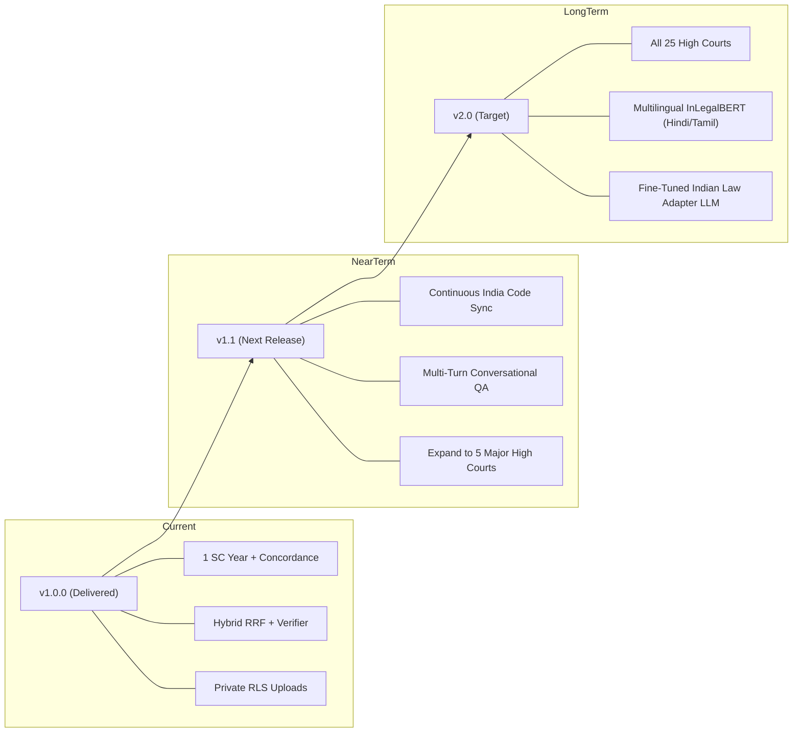

# LegalJarvis: Limitations and Future Work

**Document:** `docs/limitations_and_future_work.md`  
**PRD Reference:** Part D4, Part D16, Task T-22  
**Version:** 1.0.0  

---

## 1. Explicit Scope & Legal Boundary

> [!CAUTION]
> **No Claim of Real-World Legal Practice Validation**: LegalJarvis is an engineering prototype and research system designed to evaluate citation-grounded information retrieval for Indian law. It has **NOT** been approved, certified, or validated for unsupervised real-world legal practice or client representation. It must never be used as a substitute for professional advice from an advocate enrolled with a State Bar Council under the Advocates Act, 1961.

---

## 2. Technical and Operational Limitations

### A. Corpus Snapshot and Temporal Boundary
1. **Supreme Court Snapshot:** The primary ingestion pipeline operates on an initial validated baseline year (2023 Supreme Court judgments from AWS Open Data). Judgments delivered outside ingested periods are not present in the index.
2. **High Court Scope:** Ingestion of all 25 Indian High Courts comprises tens of millions of pages (~1 TB compressed tars). The v1 architecture ingests a representative High Court subset; regional trial and district courts (ecourts) are explicitly out of scope.
3. **Statute Transition Lag:** While the core criminal law concordance between the Indian Penal Code (IPC) and Bharatiya Nyaya Sanhita (BNS) is verified by human source attribution, ongoing state-level statutory amendments and notifications post-July 2024 are subject to gazette publication lag.

### B. Natural Language & Model Boundaries
1. **Language Scope:** The current pipeline processes Indian legal text in **English only**. Judgments or pleadings delivered exclusively in Hindi or regional vernacular languages are filtered out during ingestion (`extraction_status='skipped_lang'`).
2. **Generative Model Hallucinations:** Large language models remain susceptible to generating fabricated legal doctrines or conflating obiter dicta with ratio decidendi. While LegalJarvis enforces an automatic multi-stage citation verifier and abstention engine (100% citation existence check), subtle errors in statutory nuances require advocate review.
3. **Rhetorical Role Tagger:** The rhetorical role classifier (identifying facts, arguments, and ratios) is evaluated at macro-$F_1 \ge 0.70$ on the IL-TUR benchmark. Complex, non-standard judgment formats may result in misclassified paragraph types.

### C. Scalability and Infrastructure Limits
1. **Single-Node PostgreSQL Architecture:** The database architecture utilizes single-node PostgreSQL 16 with the `pgvector` extension. This comfortably handles up to 500,000 document chunks (~100 Supreme Court / High Court years) on a standard cloud VM, but distributed multi-node clustering (tens of millions of vectors) is outside the design target of v1.
2. **OCR Quality on Legacy Scans:** Extremely degraded, photocopied, or historical pre-1980 judicial scans may produce extraction quality scores below 0.60 and are routed to manual review or dropped rather than corrupting vector indices.

---

## 3. Regulatory and Professional Compliance

1. **Bar Council of India Regulations:** Under the Advocates Act, 1961 (Sections 29 and 30), only registered advocates have the right to practice law before courts and tribunals in India. LegalJarvis explicitly rejects requests for case strategy, guaranteed outcomes, or draft filings for active disputes.
2. **Digital Personal Data Protection (DPDP) Act, 2023:** Private user uploads are treated as confidential data and isolated using PostgreSQL Row-Level Security (RLS) with automatic 30-day retention purges. Public judgments are processed in accordance with open judicial data principles recognized by the Supreme Court of India (*Swapnil Tripathi v. Supreme Court of India*).

---

## 4. Future Work Roadmap

### Planned Milestones
1. **Continuous India Code Gazette Syncing:** Automated webhook integration with India Code and e-Gazette to automatically flag newly notified sections and repealed provisions.
2. **Multi-Turn Conversational Research:** Extend the single-turn QA orchestrator into an interactive dialogue assistant capable of refining legal queries across multiple research steps.
3. **Multi-Court Ingestion (Delhi, Bombay, Madras, Calcutta, Allahabad):** Scale pgvector indexing to cover key commercial and constitutional High Courts across the 2010–2024 timeframe.
4. **Multilingual InLegalBERT Embeddings:** Incorporate multilingual neural encoders to search and synthesize vernacular judgments delivered in Hindi, Marathi, Tamil, and Bengali.
5. **Certified Advocate Gold Benchmark:** Expand the reviewer gold dataset to 1,000+ items across all Indian appellate jurisdictions with multi-advocate Cohen's kappa agreement metrics.
