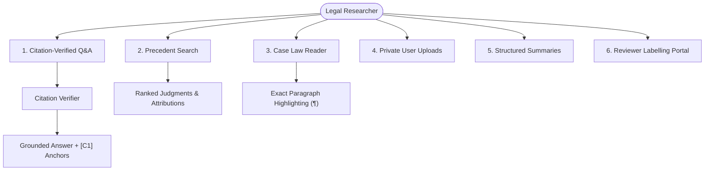

# LegalJarvis User Guide

**Document:** `docs/user_guide.md`  
**PRD Reference:** Task T-22  
**Target Audience:** Legal researchers, advocates, law students, judicial clerks, and reviewers  

---

## 1. Introduction

LegalJarvis is an automated legal research and intelligence assistant tailored specifically for Indian law (Supreme Court of India, High Courts, and Central Statutes). Unlike generic conversational AI, LegalJarvis operates under strict citation verification: every factual claim and legal proposition must cite a retrieved paragraph from authoritative Indian judgments or statutes, or the system will explicitly abstain.

> [!IMPORTANT]
> **Not Legal Advice**: LegalJarvis provides automated legal research for informational purposes only. It is not an advocate licensed by the Bar Council of India and cannot offer personalized litigation strategy or legal representation.

---

## 2. Core Features & Capabilities

---

## 3. Workflow Walkthroughs

### Workflow 1: Citation-Verified Q&A (`/v1/qa`)

1. **Navigate to the "Ask Q&A" tab.**
2. **Enter an inquiry:** Formulate questions regarding Indian legal principles, section requirements, or precedential holdings (e.g., *"What are the essential ingredients of criminal conspiracy under Section 120A of the Indian Penal Code?"*).
3. **Review the Verified Answer:**
   - The response includes bracketed citations (`[C1]`, `[C2]`).
   - Every claim is anchored directly to text in the judgment or statute.
   - If an inquiry mentions a repealed statute provision (such as IPC Section 302 or Section 420), a **Criminal Law Transition Notice** is displayed, highlighting the corresponding Bharatiya Nyaya Sanhita (BNS) provision effective 1 July 2024.
4. **Clicking a Citation Marker:**
   - Clicking any `[C1]` badge immediately switches to the **Case Law Reader** and smoothly scrolls to the exact paragraph (`#para-15`), highlighting it in yellow.

### Workflow 2: Precedent Search (`/v1/search`)

1. **Select the "Search" tab.**
2. **Execute a hybrid search:** Type factual keywords or statutory provisions (e.g., *"anticipatory bail parameters Section 438 CrPC custodial interrogation"*).
3. **Filter Results:** Filter by court level (`Supreme Court of India`, `High Court of Delhi`, etc.) or decision year range.
4. **Inspect Results:**
   - Real-time relevance score computed via Reciprocal Rank Fusion (RRF, $k=60$) combining BM25 lexical search and BGE-M3 dense embeddings.
   - High-fidelity snippets with matched terms emphasized.
   - Authoritative source attribution (e.g., Open Government Data / CC-BY-4.0).

### Workflow 3: Case Law Reader (`/v1/documents/{id}`)

1. **Accessing Full Text:** Open any judgment from search results or citation clicks.
2. **Numbered Paragraphs:** Judgments are parsed into numbered paragraphs (`¶ 1`, `¶ 2`, `¶ 3`).
3. **Rhetorical Roles:** Paragraphs are tagged by role (e.g., `FACTS`, `ARGUMENTS`, `REASONING`, `RATIO_DECIDENDI`).
4. **Metadata Bar:** Displays case title, neutral citation (e.g., `2023 INSC 1043`), bench, date of decision, and official source link.

### Workflow 4: Structured Summarisation (`/v1/summarize`)

1. **Request Structured Summary:** In the Case Viewer, click **"Generate Structured Summary"**.
2. **Standardized Legal Schema:**
   - **Issues:** Core points of law framed by the Court.
   - **Arguments:** Contentions raised by appellant and respondent.
   - **Analysis:** Statutory interpretation and precedent analysis.
   - **Ratio Decidendi:** The authoritative legal principle established.
   - **Disposition:** The final operative decree (allowed, dismissed, remanded).
3. **Paragraph Grounding:** Every summary sentence contains a required source paragraph citation (`[P14]`), preventing hallucinated holdings.

### Workflow 5: Private Document Uploads (`/v1/documents/upload`)

1. **Uploading Client Briefs / Drafts:**
   - Supported formats: PDF, DOCX, TXT (up to 20 MB).
   - Automatic paragraph segmentation and local vector indexing.
2. **Complete Cross-User Isolation:**
   - Private documents are secured by PostgreSQL Row-Level Security (RLS).
   - Only the authenticated owner can retrieve or search their uploaded documents.
   - Non-owners receive HTTP 404 responses (zero metadata enumeration).
3. **Automated Purge:**
   - Configurable retention periods (default: 30 days) after which files, chunks, vectors, and database records are permanently deleted.

### Workflow 6: Legal Reviewer Labelling Portal (`/reviewer`)

1. **Certified Advocate Evaluation:**
   - Designed for human legal experts and Bar Council advocates.
   - Evaluate answers across 5 standard rubrics: `Supported`, `Unsupported`, `Hallucinated`, `Incomplete`, `Wrong Law`.
2. **Per-Claim Verification:**
   - Reviewers toggle individual claims as verified or disputed.
   - Enter critique notes on legal nuance or jurisdictional correctness.
3. **Gold-Set Export:**
   - One-click export of verified gold labels into structured JSON for continuous benchmark evaluation (`docs/eval/eval_report.md`).

---

## 4. Keyboard Shortcuts & Accessibility

LegalJarvis conforms to WCAG 2.1 AA accessibility guidelines:
- **`Tab` / `Shift+Tab`**: Navigate forward and backward through all controls and citation buttons.
- **`Enter` / `Space`**: Activate tabs, submit queries, and jump to cited paragraphs.
- **`Escape`**: Dismiss modal dialogues and clear search inputs.
- **High-Contrast Text**: Tested with `axe-core` to ensure > 4.5:1 contrast across all views.
- **Screen Reader Support**: Full ARIA landmark markup (`aria-label`, `role="region"`, `role="status"`).
